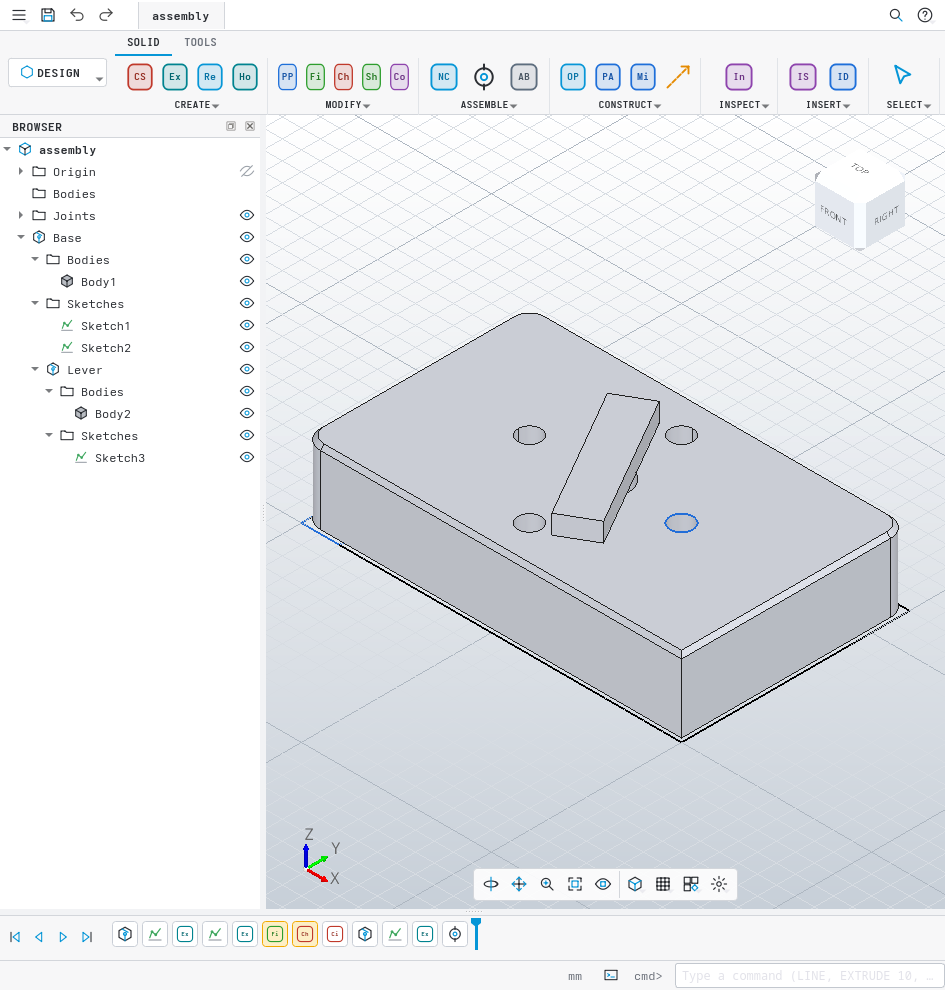

# FabriCAD

FabriCAD is an open-source, fast, lightweight parametric 3D CAD application. Its interface
and workflow follow the Fusion 360 / SolidWorks / AutoCAD model: one window, a ribbon with
toolbar tabs and group dropdowns, a browser tree, a bottom timeline with a rollback marker,
command dialogs, an S-key command search, a radial marking menu and an AutoCAD-style command
line. It makes **parts** (sketches + solid features), **assemblies** (components, joints,
motion) and **engineering drawings** (sheets, projected/section/detail views, dimensions,
parts lists; PDF/SVG/DXF export).



* Stack: C++20, CMake, Qt 6 Widgets, OpenCASCADE 7.9 (modelling kernel, HLR, STEP/STL,
  AIS/V3d viewer), Eigen (sketch and assembly solvers), FreeCAD's PlaneGCS (vendored).
* License: LGPL-2.1-or-later (`LICENSE`). Third-party code is listed in `THIRD_PARTY.md`.
* Architecture and module ownership: `docs/ARCHITECTURE.md`; design research in
  `docs/research/`; module hand-over notes in `docs/integration-notes/`.

## Features

**Sketch** (`SKETCH` contextual tab, PlaneGCS solver, Fusion-style inference)
* Line (chained, tangent-arc drag), 2-point / 3-point / centre rectangles, centre-diameter /
  2-point / 3-point circles, 3-point / centre / tangent arcs, polygons, slots, points.
* Fillet, trim (power trim), extend, break, offset, mirror, project (associative purple
  geometry from edges, faces and bodies), construction toggle (X).
* Dimensions (D): length, diameter, radius, point-point (aligned / horizontal / vertical by
  label placement), point-line, angle; driven dimensions; expressions with document parameters
  (`width/2 + 3 mm`).
* Constraints: horizontal/vertical, coincident, tangent, equal, parallel, perpendicular, fix,
  midpoint, concentric, collinear, symmetric. Conflicts are rejected, redundancy reported.
  Colours: blue free, black fully constrained, orange construction, green fixed, purple
  projected, red conflict. The status bar shows "Sketch1: 3 DOF".
* Fusion-style on-screen value boxes while drawing (line length + angle, rectangle width + height,
  circle diameter, arc radius + sweep, polygon sides + size, slot length + width, offset distance;
  extrude distance and other feature values): type a value or expression (`width/2 + 3 mm`), Tab
  locks it and moves to the next box, Enter commits; locked values drive the rubber band and become
  driving dimensions. Command-line input too: `12.5`, `10 in`, `x,y`, `@dx,dy`, `@len<ang`, `w,h`.

**Part** (`SOLID` tab)
* Extrude (one side / two sides / symmetric; distance / to object / through all; taper; join /
  cut / intersect / new body), revolve, sweep, loft, hole (simple / counterbore / countersink),
  fillet, chamfer, shell, draft, press-pull / offset face, combine, split body, move/copy body,
  rectangular / circular pattern, mirror.
* Construction: offset plane, plane at angle, tangent plane, midplane, plane through three
  points, axes, points.
* Topological naming: history names (`Extrude1/End`, `Extrude1/Side/c5`,
  `{Extrude1/Side/c1|Extrude1/Side/c2}`) plus geometric signatures, so references survive
  upstream edits; side faces are named after the sketch curve that generated them. A reference
  that had to be re-matched by geometry adopts the matched shape's fingerprint and history name,
  so successive edits never drift past the acceptance threshold.
* Editing a feature rolls the timeline marker to just after it, so every keystroke recomputes
  that feature only; the downstream history is replayed once on OK. Typed values in an edit
  dialog are applied 150 ms after typing stops.
* **Measure / Inspect** (`INSPECT > Measure`, I): one entity gives position, length, radius /
  diameter, area, perimeter, volume, surface, centre of mass, bounding box, material, density and
  mass; two entities give the minimum distance with delta X/Y/Z (drawn in the view), the angle
  between planes / lines, centre distances and plane offsets. Rows are copyable.
* Physical material (built-in table of 26 metals, plastics, woods and others with density and
  colour; custom name + density), appearance colour and component part number / description /
  material from the browser context menu, all undoable. Parts lists, the BOM CSV and Measure read
  them back (mass = volume x density).
* STEP / STL import (as a timeline feature) and export.

**Assembly** (`ASSEMBLE` group)
* Components and occurrences, ground, activate (in-context editing with ghosting), rigid groups.
* Joints: rigid, revolute, slider, cylindrical, pin-slot, planar, ball; as-built joints; limits;
  offsets; live preview while picking snap points; drive joints (slider, value, animate);
  move component with a triad manipulator (inverse kinematics on jointed components).
* Solver: tree propagation from grounded components plus a Levenberg-Marquardt phase for closed
  loops (four-bar linkages work).
* Copy / Paste of components (Ctrl+C / Ctrl+V, browser context menu): paste inserts an
  occurrence of the copied component's definition under the active component and hands it to
  the Move triad, so four identical bolts are four occurrences and the BOM quantity reads 4.
* Joints are edited with the Joint tool itself (double-click a joint): the motion type, offsets,
  limits and both snaps can be changed with a live solver preview; OK is one undo step.
* Interference check, BOM (CSV), XCAF STEP export with occurrences, names and colours.

**Drawing** (`DRAWING` workspace)
* ISO / ASME sheets A4..A0 / ANSI A..E, title block, base views (front/top/right/iso/...),
  projected views (first/third angle, aligned), section views (hatched), detail views, hidden
  and tangent edges, centre marks and centre lines.
* Associative dimensions (linear / aligned / radius / diameter / angle), notes, leaders,
  balloons and parts lists (BOM). Dimensions, centre marks and centre lines reference edges by
  the part's history name (then by the edge's geometric fingerprint, then by index only when the
  edge is still where it was picked); after a model edit a dimension reads the new value or turns
  into a red `?` (orphaned) instead of jumping to another edge.
* Automatic view layout: projected and section views are placed at least a gap away from their
  parent (parent half-size + child half-size + 15 mm), pushed clear of other views, kept inside
  the frame and above the title block; a parts list dropped on the title block snaps above it.
* Export: PDF, SVG, DXF (R12), CSV. HLR runs on a worker thread.

**Application shell**
* Ribbon built from the tool registry, browser (visibility eyes, rename, context menus,
  features listed under their component), timeline (rollback marker drag, drag-reorder,
  suppress, edit by double-click), command dialogs with live preview, status bar, marking menu,
  command search (S), command line (Ctrl+9), change-parameters dialog, Fusion / SolidWorks /
  AutoCAD / Inventor navigation presets, ViewCube, nav bar.
* `.fcad` documents (plain JSON, parametric definition only) with per-document UI state.
* Autosave: a recovery copy is written to `QStandardPaths::AppDataLocation/recovery` two
  minutes after the last change and five seconds after each undoable edit; at the next start
  FabriCAD offers to recover it. A clean save or close removes the copy.

## Building (Arch Linux dev box)

Requirements (all system packages, nothing is downloaded): `cmake >= 3.25`, `g++ >= 13`
(C++20, `std::format`), `qt6-base qt6-svg qt6-declarative`, `opencascade 7.9`, `eigen`,
`onetbb` (optional), `lld` (optional, used automatically).

```sh
cmake -S . -B build -DCMAKE_BUILD_TYPE=Release -DCMAKE_CXX_FLAGS_RELEASE="-O2 -DNDEBUG"
cmake --build build -j2                      # ALWAYS -j2 on this machine (7 GB RAM)
ctest --test-dir build --output-on-failure   # 33 tests, headless (QT_QPA_PLATFORM=offscreen)
./build/bin/fabricad [file.fcad|part.step]   # run
```

Build types: `Dev` (default, `-O1 -g1`, fast compile), `Debug`, `Release`. Options:
`-DFABRICAD_BUILD_TESTS=OFF`, `-DFABRICAD_USE_LLD=OFF`, `-DFABRICAD_WERROR=ON`.

Tests: every `src/<module>/tests/test_*.cpp` is one ctest entry; `tests/e2e/test_e2e.cpp`
drives the whole product headlessly through the tool ids the UI uses (sketch -> extrude ->
hole -> fillet -> chamfer -> pattern -> save/reload -> dimension edit -> second component ->
revolute joint -> drawing with views, section, dimensions and parts list -> model edit under the
drawing (the dimension follows the edge, the layout stays inside the frame without overlaps) ->
STEP / STL / PDF / SVG / DXF / CSV export into `build/e2e-out/`).

Sanitizer run (CI): `scripts/asan-loop.sh [iterations]` configures `build-asan` with
`-DFABRICAD_SANITIZE=ON` (ASan + UBSan) and runs the GUI tool tests in a loop; it guards the
PropertyPanel rebuild path that used to delete a combo box from inside its own signal.

### Is this computer powerful enough?

Yes. OCCT and Qt are prebuilt system packages; FabriCAD only compiles its own ~57k lines.
A clean Release build of everything (libraries, app, 33 test executables) takes about 25
minutes at `-j2` on the 8-thread / 7 GB machine; incremental builds take seconds to a couple
of minutes. The full test suite runs in under 5 seconds. The application shows its window
about 130-170 ms after launch and the OCCT 3D view is ready after about 460 ms (XWayland);
the process needs a few hundred MB. Keep builds at `-j2`: single translation units that
include OCCT and Qt headers peak at 0.3-1.2 GB each, and that is the only real limit of this
machine. Not feasible here: building OCCT/FreeCAD from source, or running the OpenGL viewer
headless (no Xvfb), which is why all core logic is testable without a GL context.

### Display server note

The system OCCT is an X11/GLX build. The desktop exports `QT_QPA_PLATFORM="wayland;xcb"`,
which would start Qt on Wayland and leave the 3D view dead, so `main()` switches to `xcb`
(XWayland) whenever `DISPLAY` is set and the variable is empty or starts with `wayland`.
`FABRICAD_ALLOW_WAYLAND=1` opts out; `QT_QPA_PLATFORM=offscreen` is kept (tests, scripts).

Developer environment variables: `FABRICAD_STARTUP_TIMING=1` prints the startup phases,
`FABRICAD_SCREENSHOT=out.png` (+ `FABRICAD_SCREENSHOT_DELAY` ms) grabs the window and quits,
`FABRICAD_QUIT_AFTER_STARTUP=1` exits after the first frame.

## Usage

1. **Sketch**: Create Sketch (`CS` button or type `SKETCH XY`), pick a plane or a planar face,
   draw with L / R / C / arcs, dimension with D (type the value), constrain with the
   CONSTRAINTS buttons, Finish Sketch (Ctrl+Return).
2. **Part**: select a profile (shaded), press E (Extrude), type the distance, choose Join /
   Cut / New Body in the dialog, OK (Enter). Press Pull (Q) dispatches to offset face / fillet /
   extrude depending on what you pick. F = Fillet, H = Hole.
3. **Edit**: double-click a timeline item or browser entry; drag the rollback marker; right-click
   for Suppress / Roll History Marker Here / Rename / Delete.
4. **Assembly**: New Component (N), then model inside it (the browser shows bodies, sketches
   and joints under their component). Joint (J): click a snap point on the moving component,
   then on the fixed one; choose the motion type; drive it with Drive Joints.
5. **Drawing**: `DESIGN` dropdown -> `DRAWING` (or type `DRAWING`), place a base view, press P
   and click to the side for projected views, Section / Detail / Dimension / Parts List /
   Balloon, then Output PDF/SVG/DXF.
6. **Command line** (Ctrl+9 or `:`): `EXTRUDE 10`, `BASEVIEW front 1:2 150,120`,
   `PROJ right above iso`, `DIM 150,105 150,90`, `PDF /tmp/out.pdf`, `app.save part.fcad`.

## Keyboard shortcuts

| Key | Command | Key | Command |
|---|---|---|---|
| S | Command search | Esc | Cancel / clear selection |
| Enter / Space | OK / repeat last command | Ctrl+Return | Finish Sketch |
| L | Line | R | 2-point rectangle |
| C | Centre-diameter circle | D | Dimension (sketch / drawing) |
| T | Trim (sketch) / Text (drawing) | O | Offset |
| X | Construction toggle | P | Project (sketch) / Projected view (drawing) |
| E | Extrude | Q | Press Pull |
| F | Fillet | H | Hole |
| M | Move | N | New Component |
| J | Joint | Shift+J | As-built Joint |
| V | Show / hide | Del | Delete |
| F6 | Fit | Home | Home view |
| Ctrl+1..7 | Front / Back / Left / Right / Top / Bottom / Iso | Ctrl+8 | Look At |
| Shift+arrows | Orbit | Ctrl+9 | Command line |
| Ctrl+Z / Ctrl+Y | Undo / Redo | Ctrl+S / Ctrl+Shift+S | Save / Save As |
| Ctrl+N / Ctrl+O | New / Open | Ctrl+B | Compute All |
| F1 | Shortcut help | RMB click / drag | Marking menu |

Mouse (Fusion preset): MMB pan, Shift+MMB orbit, wheel zoom at cursor, MMB double-click fit,
LMB select (Ctrl toggle, Shift add, window / crossing box), double-click = edit.

## Repository layout

```
CMakeLists.txt            top-level build; tests/e2e/ end-to-end test
cmake/                    helpers: fabricad_add_module(), fabricad_add_tests()
docs/ARCHITECTURE.md      design + ownership table (read this first)
docs/integration-notes/   module hand-over notes and core change requests (processed)
docs/research/            research notes (OCCT/FreeCAD, UX spec, algorithms)
docs/screenshots/         screenshots used by this README
src/core/                 fabricad_core: document model, features, undo, selection, tool registry
src/sketch/               fabricad_sketch: 2D sketcher, constraints (PlaneGCS), profiles, tools
src/part/                 fabricad_part: solid features, construction geometry, naming, STEP/STL
src/assembly/             fabricad_assembly: components, joints, solver, BOM, XCAF export
src/drawing/              fabricad_drawing: sheets, HLR views, dimensions, PDF/SVG/DXF
src/viewer/               fabricad_viewer: OCCT 3D view in Qt (QOpenGLWidget)
src/app/                  fabricad executable: main window, ribbon, browser, timeline, dialogs
resources/                icons, stylesheet (.qrc)
```

## Known limitations

* Sketch: no ellipse / spline / conic / text, no sketch patterns, move/copy, scale or chamfer;
  non-circular projected edges become chords; absolute `x,y` coordinates typed while drawing
  place points without constraints; value boxes have no drag handles.
* Part: constant-radius fillets only; no Thread feature or thread spec on Hole (hole placement
  only on sketch points, vertices or circular edges); no Box/Cylinder/Sphere/Torus/Coil
  primitives, Rib, Thicken, Replace Face or Scale; feature values have no on-canvas drag arrows
  (only Move Component has a manipulator). Chamfers that OCCT propagates along tangent chains
  (e.g. over a fillet) leave those generated faces unnamed.
* Assembly: no motion links or contact sets; Paste New (independent copy) is not available and
  rectangular / circular patterns do not take components; component ids are not preserved
  across undo -> redo of a component creation.
* Drawing: single straight section line; no hole/thread callouts, ordinate / baseline / chain
  dimensions, tolerances, GD&T frames, datums, surface finish or weld symbols, break views or
  revision tables. Section views reference edges by index + position (no history names).
* App: toolbar / timeline icons without an SVG are generated two-letter badges; single document
  window (autosave + recovery exist, tabs do not); light theme only; no "Select Other".
