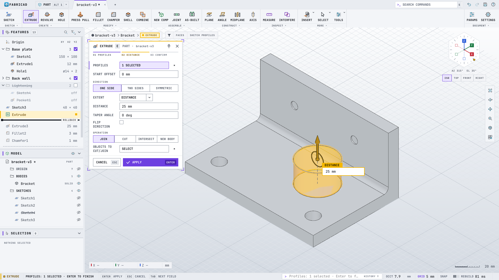

# FabriCAD

FabriCAD is an open-source, fast, lightweight parametric 3D CAD application. Its workflow
follows the Fusion 360 / SolidWorks / AutoCAD model (one window, history-based features, an S-key
command search, a radial marking menu and an AutoCAD-style command line) in its own dark or light
interface: a sectioned toolbar, a sidebar with the feature list, the model tree and the selection,
a command card with live previews, and a hex orientation dial. It makes **parts** (sketches + solid
features), **assemblies** (components, joints, motion) and **engineering drawings** (sheets,
projected/section/detail views, dimensions, parts lists; PDF/SVG/DXF export).


**New here? Read the [user guide](docs/USER_GUIDE.md)**: the window, navigation, sketching, parts,
assemblies, drawings, import/export, Preferences and the full shortcut table.

More screenshots: [chair, dark](docs/screenshots/fabricad-assembly.png),
[extrude, light](docs/screenshots/fabricad-extrude-light.png),
[drawing, light](docs/screenshots/fabricad-drawing-light.png),
[empty window, dark](docs/screenshots/fabricad-empty.png) and [light](docs/screenshots/fabricad-empty-light.png).
They are regenerated with `tools/uitest/readme-shots.sh build/bin/fabricad`.

* Stack: C++20, CMake, Qt 6 Widgets, OpenCASCADE 7.9 (modelling kernel, HLR, STEP/STL,
  AIS/V3d viewer), Eigen (sketch and assembly solvers), FreeCAD's PlaneGCS (vendored).
* License: LGPL-2.1-or-later (`LICENSE`). Third-party code is listed in `THIRD_PARTY.md`.
* Architecture and module ownership: `docs/ARCHITECTURE.md`; design research in
  `docs/research/`; module hand-over notes in `docs/integration-notes/`.

## Features

**Sketch** (`SKETCH` contextual tab, PlaneGCS solver, Fusion-style inference)
* Line (chained, tangent-arc drag), 2-point / 3-point / centre rectangles, centre-diameter /
  2-point / 3-point circles, 3-point / centre / tangent arcs, polygons, slots, points, ellipses
  and elliptical arcs, fit-point and control-point splines, text (font outlines, usable as an
  extrude profile).
* Fillet, chamfer, trim (power trim), extend, break, offset, mirror, project (associative purple
  geometry from edges, faces and bodies), construction toggle (X), move/copy, rotate, scale,
  rectangular and circular sketch patterns. A sketch fillet or chamfer on a dimensioned corner
  keeps the dimension meaningful (it measures to the virtual sharp, as in Fusion).
* Dimensions (D): length, diameter, radius, point-point (aligned / horizontal / vertical by
  label placement), point-line, angle; driven dimensions; expressions with document parameters
  (`width/2 + 3 mm`).
* Constraints: horizontal/vertical, coincident, tangent, equal, parallel, perpendicular, fix,
  midpoint, concentric, collinear, symmetric. Conflicts are rejected, redundancy reported.
  Colours: blue free, white (dark theme) / black (light) fully constrained, dashed grey
  construction, green with a lock fixed, dash-dot cyan projected, crimson with a warning glyph
  conflict. The status bar shows "Sketch1: 3 DOF".
* Fusion-style on-screen value boxes while drawing (line length + angle, rectangle width + height,
  circle diameter, arc radius + sweep, polygon sides + size, slot length + width, offset distance;
  extrude distance and other feature values): type a value or expression (`width/2 + 3 mm`), Tab
  locks it and moves to the next box, Enter commits; locked values drive the rubber band and become
  driving dimensions. Command-line input too: `12.5`, `10 in`, `x,y`, `@dx,dy`, `@len<ang`, `w,h`.

**Part** (`SOLID` tab)
* Extrude (one side / two sides / symmetric; distance / to object / through all; taper; join /
  cut / intersect / new body), revolve, sweep, loft, hole (simple / counterbore / countersink;
  simple / clearance (ISO 273) / tapped with cosmetic or modelled thread; placed by clicking
  faces), fillet (constant or variable radius), chamfer, shell, draft, press-pull / offset face,
  combine, split body, split face, move/copy body (free move with typed rotations), scale,
  rectangular / circular pattern (bodies, features or components), mirror, rib, thicken.
* Primitives: box, cylinder, sphere, torus and coil (spring) placed on a plane, sketch or face.
  Thread feature: ISO 261 metric coarse / fine sizes on rods and holes, cosmetic or modelled.
* On-canvas manipulators (Fusion-style arrows and rings) on extrude, revolve, fillet, chamfer,
  shell, press pull / offset face, offset plane, hole, box / cylinder / sphere / torus / coil,
  thicken and rib: drag with 1-2-5 snapping (Shift coarser, Ctrl free), Esc aborts the drag;
  an extrude dragged into material switches Join -> Cut. The feature's value box sits at the
  arrow tip: type a value or expression there, Enter commits.
* Construction: offset plane, plane at angle, tangent plane, midplane, plane through three
  points, axes, points.
* Topological naming: history names (`Extrude1/End`, `Extrude1/Side/c5`,
  `{Extrude1/Side/c1|Extrude1/Side/c2}`) plus geometric signatures, so references survive
  upstream edits; side faces are named after the sketch curve that generated them. A reference
  that had to be re-matched by geometry adopts the matched shape's fingerprint and history name,
  so successive edits never drift past the acceptance threshold.
* Editing a feature rolls the timeline marker to just after it, so every keystroke recomputes
  that feature only; the downstream history is replayed once on OK. Typed values in an edit
  dialog are applied 150 ms after typing stops.
* **Measure / Inspect** (`INSPECT > Measure`, I): one entity gives position, length, radius /
  diameter, area, perimeter, volume, surface, centre of mass, bounding box, material, density and
  mass; two entities give the minimum distance with delta X/Y/Z (drawn in the view), the angle
  between planes / lines, centre distances and plane offsets. Rows are copyable.
* Physical material (built-in table of 26 metals, plastics, woods and others with density and
  colour; custom name + density), appearance colour and component part number / description /
  material from the browser context menu, all undoable. Parts lists, the BOM CSV and Measure read
  them back (mass = volume x density).
* STEP / STL import (as a timeline feature) and export; an assembly STEP keeps its structure
  (components, shared parts as occurrences, product names; "Keep assembly structure"); the STL export dialog sets the linear and
  angular deflection and the format (binary / ASCII) and remembers them.
* Booleans are scoped like Fusion: a Join / Cut without an explicit target list only touches bodies
  of the active component's tree, a Hole cuts the body it is placed on, and the first feature of an
  empty component defaults to New Body.

**Assembly** (`ASSEMBLE` group)
* Components and occurrences, ground / unground, activate (in-context editing with ghosting),
  rigid groups; deleting a component hands its bodies and child components to its parent (children
  keep their world placement). Move Component takes typed X/Y/Z distances, X/Y/Z angles and the
  pivot point the angles turn about.
* Joints: rigid, revolute, slider, cylindrical, pin-slot, planar, ball; as-built joints; limits;
  offsets; live preview while picking snap points; drive joints (slider, value, animate);
  move component with a triad manipulator (inverse kinematics on jointed components).
* Solver: tree propagation from grounded components plus a Levenberg-Marquardt phase for closed
  loops (four-bar linkages work).
* Copy / Paste of components (Ctrl+C / Ctrl+V, browser context menu): paste inserts an
  occurrence of the copied component's definition under the active component and hands it to
  the Move triad, so four identical bolts are four occurrences and the BOM quantity reads 4.
  Paste New (Ctrl+Shift+V) makes an independent deep copy with its own feature history.
* The Move / Rotate triad and the Drive Joint ring are viewer manipulators (only the joint's
  degrees of freedom are offered on a jointed component).
* Joints are edited with the Joint tool itself (double-click a joint): the motion type, offsets,
  limits and both snaps can be changed with a live solver preview; OK is one undo step.
* Interference check, BOM (CSV), XCAF STEP export with occurrences, names and colours.

**Drawing** (`DRAWING` workspace)
* ISO / ASME sheets A4..A0 / ANSI A..E, title block, base views (front/top/right/iso/...),
  projected views (first/third angle, aligned), section views (hatched), detail views, hidden
  and tangent edges, centre marks and centre lines.
* Associative dimensions (linear / aligned / radius / diameter / angle), notes, leaders,
  balloons and parts lists (BOM). Dimensions, centre marks and centre lines reference edges by
  the part's history name (then by the edge's geometric fingerprint, then by index only when the
  edge is still where it was picked); after a model edit a dimension reads the new value or turns
  into a red `?` (orphaned) instead of jumping to another edge.
* Automatic view layout: projected and section views are placed at least a gap away from their
  parent (parent half-size + child half-size + 15 mm), pushed clear of other views, kept inside
  the frame and above the title block; a parts list dropped on the title block snaps above it.
* Tolerances on every dimension (symmetric, deviation, limits, basic, reference) and ISO 286
  fits (`H7/g6`, IT grades, clearance / transition / interference analysis); GD&T feature
  control frames, datum identifiers, ISO 1302 surface texture symbols, hole and thread callouts
  read from the solid (counterbore, countersink, depth, drill point, instance count, tapped
  hole data), ordinate / baseline / chain dimensions, revision tables that fill the title block.
* Break views, stepped (offset) and aligned section views. Symbols are drawn as geometry so
  PDF, SVG and DXF match.
* Export: PDF, SVG, DXF (R12), CSV. HLR runs on a worker thread.

**Application shell** (see [The user interface](#the-user-interface))
* Toolbar built from the tool registry, sidebar feature list (rollback bar drag, drag-reorder,
  groups, suppress, edit by double-click), model tree (visibility eyes, rename, context menus,
  features listed under their component), selection panel, command card with live preview,
  status bar, marking menu, command search (S), command line (Ctrl+9), change-parameters dialog,
  Fusion / SolidWorks / AutoCAD / Inventor navigation presets, hex orientation dial or ViewCube,
  view-tool column.
* Dark and light themes from one set of design tokens (`resources/theme/tokens.json`, generated
  into C++ and the stylesheet; a colour lint keeps literals out of the code).
* A consistent generated SVG icon set in a dark and a light variant (one icon per tool, feature
  type and shell item; `resources/icons/generate_icons.py`, contact sheets in
  `docs/screenshots/icons-dark.png` and `icons-light.png`); a test fails when a tool has no icon.
* Document tabs like Fusion: every design and every drawing is a tab in the title bar
  with its own document, undo stack, selection, active command, camera, browser and timeline;
  New/Open make a tab, a drawing opens as a tab linked to its design, closing prompts for
  unsaved changes.
* Scripting / batch mode: `fabricad --script file.fcs [--offscreen] [--log out.txt]` runs a
  text file of command-line entries exactly as if typed (`SKETCH XY`, `RECT`, `0,0`, `40,30`,
  `FINISH`, `SELECT profile:@20,15,0`, `EXTRUDE 10`, `OK`, `CHECK body:Body1 volume == 12000`,
  `EXPORTSTL out.stl`, `SELECT body:"Leg Frame"`), with geometry selectors by name/point, per-command timing in the log and
  a non-zero exit status on error. See `docs/SCRIPTING.md`; `tests/scripts/chair.fcs` builds the
  chair benchmark of `docs/comparison/CHAIR_SPEC.md`.
* `.fcad` documents (plain JSON, parametric definition only) with per-document UI state.
* Autosave: a recovery copy of every modified document is written to
  `QStandardPaths::AppDataLocation/recovery/<session>/` (one locked folder per running
  instance, one file per document) every two minutes and five seconds after each undoable
  edit; at the next start FabriCAD offers to recover every copy left by instances that are no
  longer running, each into its own tab. A recovered document is autosaved again at once. A
  clean save or close removes the copy.

## The user interface



* **Title bar**: the FabriCAD menu, the workspace selector (PART / ASSEMBLY / DRAWING, Alt+1..3),
  angled document tabs (one per design or drawing, a neutral dot marks unsaved changes), the
  command search box (S) and undo / redo / save.
* **Toolbar**: one row of captioned sections (SKETCH, CREATE, MODIFY, ASSEMBLE, CONSTRUCT, INSPECT,
  a MORE section for surface and utility tools, and the DOCUMENT section with Parameters and
  Settings). While sketching the contextual SKETCH sections replace them and a green FINISH SKETCH
  button sits at the right. A narrow window collapses sections into their caption menus. The
  toolbar can sit at the top, left or right.
* **Sidebar**: FEATURES (the timeline as a list: groups, suppress boxes, error / warning bars, the
  ROLLBACK bar you drag, F2 rename, Space suppress), MODEL (bodies, sketches, construction,
  parameters, visibility eyes) and SELECTION (type, source and measurements of what is selected).
  The classic bottom timeline strip is still available.
* **Command card**: the active command's inputs with a step indicator (01 PROFILE, 02 DISTANCE,
  03 CONFIRM), segmented controls for short choices (one side / symmetric / two sides, join / cut /
  intersect / new body), expressions echoed under length fields, CANCEL (Esc) and APPLY (Enter).
  It floats at the right or left of the view, docks into the sidebar, or stays where you drag it.
* **Viewport**: a gradient background with the grid, two-tone live previews (gold fill and outline,
  with a halo so they read over any body), on-canvas value boxes, the hex orientation dial (or the
  OCCT ViewCube), a breadcrumb of what is being edited, the selection filter bar, the view-tool
  column, cursor coordinates and a scale bar. An optional quick toolbar holds the most used tools.
* **Status bar**: the current prompt with key hints, the command line (Ctrl+9 or `:`), units, grid,
  snap and the rebuild time.
* **Drawings** keep white paper and black ink in both themes; only the area around the sheet and
  the panels follow the theme.

**Colours have one meaning each**: purple is selection and UI state, gold is a live operation
(the preview, the edited feature, the active value box), crimson with an octagon is an error,
orange-red with a triangle is a warning. Shapes and text always back up the colour, and the palette
is checked for contrast (WCAG) and for protanopia, deuteranopia and tritanopia
(`docs/plans/ui-redesign.md` section 4). UI text is bold monospaced caps (JetBrains Mono, bundled);
names you type keep their case.

### Themes, layout options and Preferences

Settings (the gear in the toolbar's DOCUMENT section, or the `app.preferences` command) has four
pages. Every Appearance and Layout choice applies at once and is remembered.

| Page | Settings |
|---|---|
| General | default length and angle units for new designs, zoom direction |
| Document | the active design's units and display precision (undoable) |
| Appearance | **Theme** Dark (default) / Light / Follow system; **UI scale** 90-130 %; glow on live handles and the active card; viewport scanline texture (off by default) |
| Layout | **Toolbar** top / left / right; **Sidebar** left / right; **Command card** float right / float left / in the sidebar / where dragged (and whether a dragged position is remembered); **Quick toolbar** off / left / right; **Orientation** hex dial / view cube; **Timeline** feature list / bottom strip |

`THEME dark|light|system` on the command line switches the theme (no argument toggles dark and
light). The settings are stored with QSettings under `ui/*` (`~/.config/FabriCAD/FabriCAD.conf`).

## Installing

**Arch Linux (AUR)**: `fabricad` (latest release) or `fabricad-git` (latest commit), e.g.
`yay -S fabricad`. The PKGBUILDs live in `packaging/aur/`; to build one by hand:

```sh
git clone https://aur.archlinux.org/fabricad.git && cd fabricad && makepkg -si
```

**From source, any distribution** (Qt >= 6.5 with Svg, OpenCASCADE 7.9, Eigen 3/5, CMake >= 3.25,
a C++20 compiler; `rsvg-convert` or ImageMagick for the PNG icons):

```sh
cmake -S . -B build -DCMAKE_BUILD_TYPE=Release -DCMAKE_INSTALL_PREFIX=/usr -DFABRICAD_BUILD_TESTS=OFF
cmake --build build -j2
sudo cmake --install build        # or: DESTDIR=/tmp/stage cmake --install build
```

`cmake --install` puts in place `bin/fabricad` (icons, theme and fonts are compiled into it), the
desktop entry `io.github.maxdtm.FabriCAD.desktop`, AppStream metainfo, the
`application/x-fabricad` MIME type for `*.fcad` files, hicolor icons (scalable + 16..512 px,
all rendered from `resources/icons/app/fabricad-app.svg` by `packaging/linux/render-icons.sh`)
and the licence notices (`share/licenses/fabricad/`). Release notes: `CHANGELOG.md`.

## Building (Arch Linux dev box)

Requirements (all system packages, nothing is downloaded): `cmake >= 3.25`, `g++ >= 13`
(C++20, `std::format`), `qt6-base qt6-svg qt6-declarative`, `opencascade 7.9`, `eigen`,
`onetbb` (optional), `lld` (optional, used automatically).

```sh
cmake -S . -B build -DCMAKE_BUILD_TYPE=Release -DCMAKE_CXX_FLAGS_RELEASE="-O2 -DNDEBUG"
cmake --build build -j2                      # ALWAYS -j2 on this machine (7 GB RAM)
ctest --test-dir build --output-on-failure   # 53 tests, headless (QT_QPA_PLATFORM=offscreen)
./build/bin/fabricad --script tests/scripts/chair.fcs --offscreen   # scripted run, docs/SCRIPTING.md
./build/bin/fabricad [file.fcad|part.step]   # run
```

Build types: `Dev` (default, `-O1 -g1`, fast compile), `Debug`, `Release`. Options:
`-DFABRICAD_BUILD_TESTS=OFF`, `-DFABRICAD_USE_LLD=OFF`, `-DFABRICAD_WERROR=ON`.

Tests: every `src/<module>/tests/test_*.cpp` is one ctest entry; `tests/e2e/test_e2e.cpp`
drives the whole product headlessly through the tool ids the UI uses (sketch -> extrude ->
hole -> fillet -> chamfer -> pattern -> save/reload -> dimension edit -> second component ->
revolute joint -> drawing with views, section, dimensions and parts list -> model edit under the
drawing (the dimension follows the edge, the layout stays inside the frame without overlaps) ->
STEP / STL / PDF / SVG / DXF / CSV export into `build/e2e-out/`).

Sanitizer run (CI): `scripts/asan-loop.sh [iterations]` configures `build-asan` with
`-DFABRICAD_SANITIZE=ON` (ASan + UBSan) and runs the GUI tool tests in a loop; it guards the
PropertyPanel rebuild path that used to delete a combo box from inside its own signal. Full
sanitizer ctest runs and the fuzz drivers for the `.fcad` loader, `.fcs` scripts and STEP/STL
import (`-DFABRICAD_FUZZ=ON`): [docs/TESTING.md](docs/TESTING.md).

### Is this computer powerful enough?

Yes. OCCT and Qt are prebuilt system packages; FabriCAD only compiles its own ~57k lines.
A clean Release build of everything (libraries, app, 33 test executables) takes about 25
minutes at `-j2` on the 8-thread / 7 GB machine; incremental builds take seconds to a couple
of minutes. The full test suite runs in under 5 seconds. The application shows its window
about 130-170 ms after launch and the OCCT 3D view is ready after about 460 ms (XWayland);
the process needs a few hundred MB. Keep builds at `-j2`: single translation units that
include OCCT and Qt headers peak at 0.3-1.2 GB each, and that is the only real limit of this
machine. Not feasible here: building OCCT/FreeCAD from source, or running the OpenGL viewer
headless (no Xvfb), which is why all core logic is testable without a GL context.

### Display server note

The system OCCT is an X11/GLX build. The desktop exports `QT_QPA_PLATFORM="wayland;xcb"`,
which would start Qt on Wayland and leave the 3D view dead, so `main()` switches to `xcb`
(XWayland) whenever `DISPLAY` is set and the variable is empty or starts with `wayland`.
`FABRICAD_ALLOW_WAYLAND=1` opts out; `QT_QPA_PLATFORM=offscreen` is kept (tests, scripts).

Developer environment variables: `FABRICAD_STARTUP_TIMING=1` prints the startup phases,
`FABRICAD_SCREENSHOT=out.png` (+ `FABRICAD_SCREENSHOT_DELAY` ms) grabs the window and quits,
`FABRICAD_WINDOW_SIZE=1920x1080` fixes the window size, `FABRICAD_GEOMETRY_DUMP=geo.json` writes the
widget boxes (for `tools/uitest/compare.py`), `FABRICAD_THEME=dark|light` overrides the theme,
`FABRICAD_QUIT_AFTER_STARTUP=1` exits after the first frame. `QT_SCALE_FACTOR=1.5` checks HiDPI.

GUI checks: `tools/uitest/` has the Xwayland harness (`ui.sh`), a screenshot-vs-mockup comparison
(`compare.py`, against `docs/mockups/custom-ui-extrude-v6-tokens-{dark,light}.svg`) and a
colour-vision simulation (`cvd.py`); see `tools/uitest/README.md`.

## Usage

1. **Sketch**: Create Sketch (`CS` button or type `SKETCH XY`), pick a plane or a planar face,
   draw with L / R / C / arcs, dimension with D (type the value), constrain with the
   CONSTRAINTS buttons, Finish Sketch (Ctrl+Return).
2. **Part**: select a profile (shaded), press E (Extrude), type the distance, choose Join /
   Cut / New Body in the dialog, OK (Enter). Press Pull (Q) dispatches to offset face / fillet /
   extrude depending on what you pick. F = Fillet, H = Hole.
3. **Edit**: double-click a row in FEATURES or MODEL; drag the ROLLBACK bar; right-click
   for Suppress / Roll History Marker Here / Rename / Delete.
4. **Assembly**: New Component (N), then model inside it (the browser shows bodies, sketches
   and joints under their component). Joint (J): click a snap point on the moving component,
   then on the fixed one; choose the motion type; drive it with Drive Joints.
5. **Drawing**: workspace selector -> `DRAWING` (Alt+3, or type `DRAWING`), place a base view, press P
   and click to the side for projected views, Section / Detail / Dimension / Parts List /
   Balloon, then Output PDF/SVG/DXF.
6. **Command line** (Ctrl+9 or `:`): `EXTRUDE 10`, `BASEVIEW front 1:2 150,120`,
   `PROJ right above iso`, `DIM 150,105 150,90`, `PDF /tmp/out.pdf`, `app.save part.fcad`.

## Keyboard shortcuts

The complete, generated list is in [the user guide](docs/USER_GUIDE.md#12-keyboard-shortcuts)
(`tools/docs/shortcuts.py`).


| Key | Command | Key | Command |
|---|---|---|---|
| S | Command search | Esc | Cancel / clear selection |
| Enter / Space | OK / repeat last command | Ctrl+Return | Finish Sketch |
| L | Line | R | 2-point rectangle |
| C | Centre-diameter circle | D | Dimension (sketch / drawing) |
| T | Trim (sketch) / Text (drawing) | O | Offset |
| X | Construction toggle | P | Project (sketch) / Projected view (drawing) |
| E | Extrude | Q | Press Pull |
| F | Fillet | H | Hole |
| M | Move | N | New Component |
| J | Joint | Shift+J | As-built Joint |
| V | Show / hide | Del | Delete |
| F6 | Fit | Home | Home view |
| Ctrl+1..7 | Front / Back / Left / Right / Top / Bottom / Iso | Ctrl+8 | Look At |
| Shift+arrows | Orbit | Ctrl+9 | Command line |
| Ctrl+Z / Ctrl+Y | Undo / Redo | Ctrl+S / Ctrl+Shift+S | Save / Save As |
| Ctrl+N / Ctrl+O | New / Open | Ctrl+B | Compute All |
| F1 | Shortcut help | RMB click / drag | Marking menu |
| Alt+1 / 2 / 3 | Part / Assembly / Drawing workspace | F2 / Space (feature list) | Rename / suppress |

Mouse (Fusion preset): MMB pan, Shift+MMB orbit, wheel zoom at cursor, MMB double-click fit,
LMB select (Ctrl toggle, Shift add, window / crossing box), double-click = edit.

## Repository layout

```
CMakeLists.txt            top-level build; tests/e2e/ end-to-end test
cmake/                    helpers: fabricad_add_module(), fabricad_add_tests()
docs/ARCHITECTURE.md      design + ownership table (read this first)
docs/integration-notes/   module hand-over notes and core change requests (processed)
docs/research/            research notes (OCCT/FreeCAD, UX spec, algorithms)
docs/screenshots/         screenshots used by this README (dark and light)
docs/mockups/             UI mockups; *-v6-tokens-{dark,light}.svg are the redesign targets
src/core/                 fabricad_core: document model, features, undo, selection, tool registry
src/sketch/               fabricad_sketch: 2D sketcher, constraints (PlaneGCS), profiles, tools
src/part/                 fabricad_part: solid features, construction geometry, naming, STEP/STL
src/assembly/             fabricad_assembly: components, joints, solver, BOM, XCAF export
src/drawing/              fabricad_drawing: sheets, HLR views, dimensions, PDF/SVG/DXF
src/viewer/               fabricad_viewer: OCCT 3D view in Qt (QOpenGLWidget)
src/theme/                fabricad_theme: design tokens, colour math, stylesheet template
src/app/                  fabricad executable: main window, toolbar, sidebar, command card, dialogs
resources/                icons (dark + light), theme tokens and stylesheet template, fonts (.qrc)
tools/theme/              token generator and colour lint; tools/uitest/: GUI harness
```

## Known limitations

* Sketch: no conics; non-circular projected edges become chords; absolute `x,y` coordinates
  typed while drawing place points without constraints; sketch value boxes have no drag handles;
  a fillet on an oblique dimensioned corner demotes the dimension to driven (a message says so);
  offsetting curved geometry adds no offset dimension; `sketch.fillet` and the dimension tools
  keep their line-edit dialogs.
* Part: variable fillet intermediate radii apply to single-edge chains only; modelled threads are
  capped at 200 turns; rib growth is perpendicular to the curve's chord; no Replace Face; no
  manipulators yet for sweep, loft, draft, patterns, move body, scale, thread or split; only the
  first edge / face of a fillet / chamfer / shell selection carries an arrow. Chamfers that OCCT
  propagates along tangent chains (e.g. over a fillet) leave those generated faces unnamed.
* Assembly: no motion links or contact sets; component patterns re-sync their occurrences only
  from the dialog (a parameter change warns); mirror does not take components; component ids
  are not preserved across undo -> redo of a component creation.
* Drawing: stepped sections still draw the step-face edges; aligned sections have one bend; no
  weld symbols, all-around / between GD&T symbols or datum targets; ordinate labels do not
  stagger; cosmetic threads are not drawn in views (callouts read the data). Section views
  reference edges by index + position (no history names).
* App: `EXPORTSTEP` is the part exporter (the assembly XCAF export is `assembly.export-step`);
  `SCREENSHOT` is blank in
  `--offscreen` runs; the app sets its own palette and font from the theme tokens, so a desktop
  theme (qt6ct, GTK) does not leak in, and file dialogs are Qt's own (no GTK bookmarks or portal); no "Select
  Other"; the manipulator rendering was verified by hand only (no GL in the test environment).
