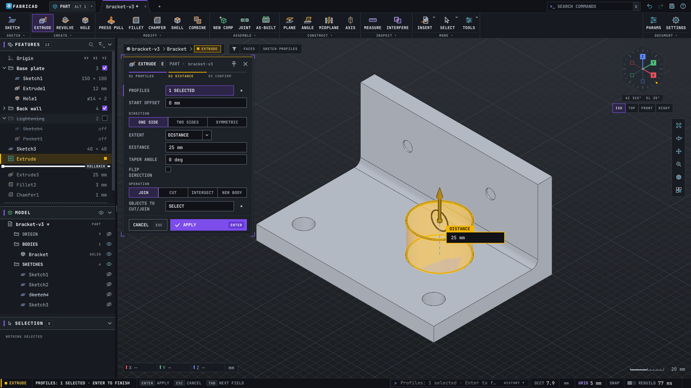
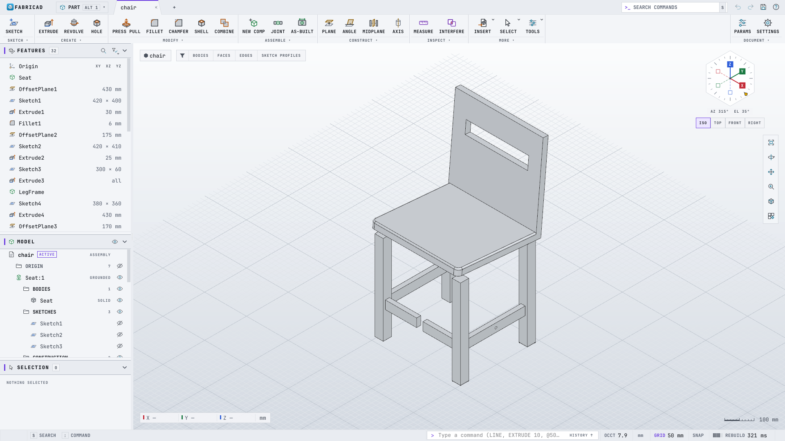
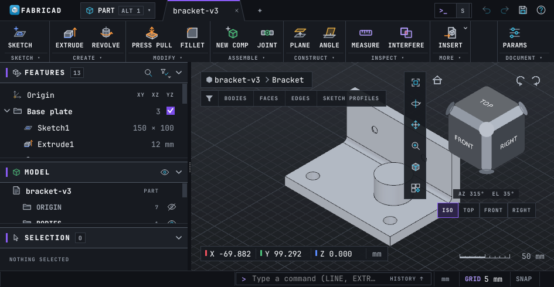
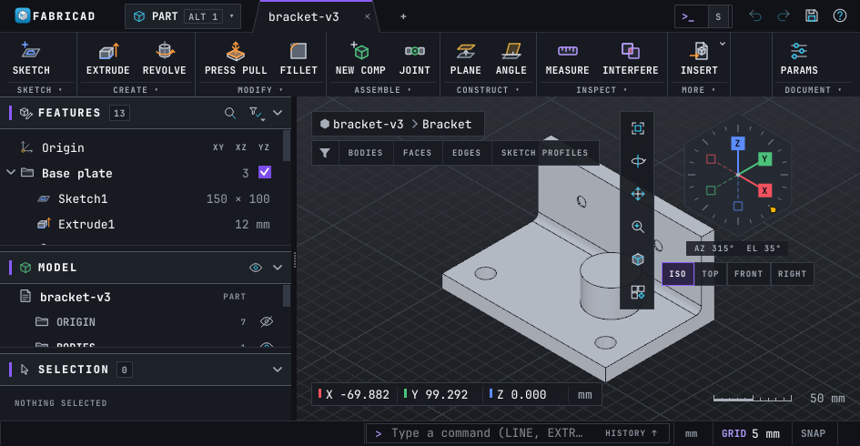
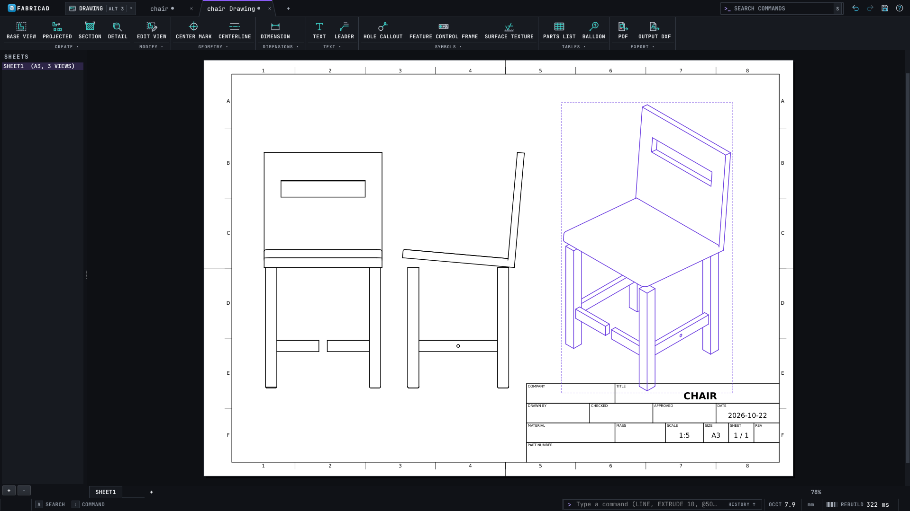

# FabriCAD user guide

FabriCAD is a parametric 3D CAD application for **parts** (sketches and solid features),
**assemblies** (components, joints, motion) and **engineering drawings** (sheets, views,
dimensions, parts lists). This guide covers the redesigned interface: what is on screen, how
to move around, and how to model, assemble, draw and exchange files.



Contents

1. [Install and run](#1-install-and-run)
2. [The window](#2-the-window)
3. [Navigating the 3D view](#3-navigating-the-3d-view)
4. [Selecting](#4-selecting)
5. [Commands: toolbar, search, command line, marking menu](#5-commands-toolbar-search-command-line-marking-menu)
6. [Sketching](#6-sketching)
7. [Part features](#7-part-features)
8. [Assemblies and joints](#8-assemblies-and-joints)
9. [Drawings](#9-drawings)
10. [Files, import and export](#10-files-import-and-export)
11. [Preferences](#11-preferences)
12. [Keyboard shortcuts](#12-keyboard-shortcuts)
13. [Scripting](#13-scripting)
14. [Troubleshooting](#14-troubleshooting)

---

## 1. Install and run

FabriCAD is built from source with CMake. It needs `cmake >= 3.25`, a C++20 compiler
(`g++ >= 13`), Qt 6 (`qt6-base`, `qt6-svg`, `qt6-declarative`), OpenCASCADE 7.9 and Eigen.
`onetbb` and `lld` are optional.

```sh
cmake -S . -B build -DCMAKE_BUILD_TYPE=Release
cmake --build build -j2          # keep -j low on machines with little RAM
./build/bin/fabricad              # empty design
./build/bin/fabricad part.fcad    # open a design
./build/bin/fabricad part.step    # open a STEP or STL file as a new design
```

The README has the build types, options and test commands.

Command-line options (`src/app/main.cpp`):

| Option | Meaning |
|---|---|
| `file.fcad`, `file.step`, `file.stl` | open the file after start-up |
| `--script file.fcs` (`-s`) | run a command script, then exit with its status (see [Scripting](#13-scripting)) |
| `--batch file.fcs` | the same as `--script file.fcs --offscreen` |
| `--offscreen` (`--headless`) | no window and no 3D view. All modelling still works. |
| `--log file`, `--quiet` (`-q`), `--keep-going` (`-k`), `--stay`, `--step-delay ms` | script options |
| `--help` (`-h`) | usage |

**Recovery.** FabriCAD autosaves every modified document every two minutes, and five seconds
after each undoable edit. The copies go to the application data folder
(`~/.local/share/FabriCAD/FabriCAD/recovery/` on Linux). If FabriCAD crashes, the next start
offers to recover each document into its own tab. A clean save or close deletes the copy.

**Guided tour.** The first launch offers "Your first part: a mounting bracket", a hands-on tour
from a first sketch to an STL; **Help > Tutorials** starts or resumes it at any time. A bubble
says what to do and points at the button, field or row; a face, edge or plane to click glows in
the view in the focus colour. The tour moves on by itself when the step is done, and all input
still goes to the app: orbit, zoom and **Home** whenever you like. **Back** (Alt+Left) undoes to
the previous step, **Show me** (F7) plays the input with a ghost cursor without changing
anything, **Skip** (Alt+Right) moves on. When something else happened, the bubble says what
(for example "That did Rename Extrude1"); the **⋯** menu has **Undo to step start**, **Restore
chapter** (the chapter's start in a new tab, your tab is kept) and **Exit tour**. A printable
copy with screenshots is in [tutorials/bracket.md](tutorials/bracket.md).

---

## 2. The window



From top to bottom, the window has a title bar, the main toolbar, then the sidebar and the
3D viewport side by side, and a status bar at the bottom.

### 2.1 Title bar

| Item | What it does |
|---|---|
| **FabriCAD** menu | New Design, Open, Open Recent, Save, Save As, Close Tab, Insert / Import, Export, Change Parameters, Show Panels (Browser, Timeline), Exit |
| **Workspace selector** | `PART` (Alt+1), `ASSEMBLY` (Alt+2), `DRAWING` (Alt+3). PART and ASSEMBLY show the same design with different toolbars: ASSEMBLY puts the ASSEMBLE section first and folds the modelling sections into their captions. DRAWING switches to the drawing of the design and creates one if needed. |
| **Document tabs** | Each design and each drawing gets its own angled tab, with its own undo history, selection, active command, camera and panels. A dot on a tab means unsaved changes. Drag tabs to reorder them. `+` makes a new design. Ctrl+W closes the active tab. |
| **Search commands** box | Opens command search (also `S` or Ctrl+K), see [5.2](#52-command-search-s--ctrlk) |
| Undo, Redo, Save | Ctrl+Z, Ctrl+Y (or Ctrl+Shift+Z), Ctrl+S |
| Find | Searches the FEATURES list by name or type (Ctrl+F) |
| Help | Keyboard Shortcuts (F1), 3D View Information (OpenGL driver details), About |

### 2.2 Main toolbar

The toolbar is one row of captioned sections:

`SKETCH | CREATE | MODIFY | ASSEMBLE | CONSTRUCT | INSPECT | MORE ▾ ... DOCUMENT`

* **SKETCH**: Create Sketch, Project to Sketch, Edit Sketch.
* **CREATE**: Extrude, Revolve, Sweep, Loft, Hole, primitives (box, cylinder, sphere, torus, coil), Thread, Rib.
* **MODIFY**: Press Pull, Offset Face, Fillet, Chamfer, Shell, Draft, Combine, Split Body / Face, Move/Copy, Scale, patterns, Mirror, Thicken.
* **ASSEMBLE**: New Component, Joint, As-built Joint, Rigid Group, Drive Joints, Move Component.
* **CONSTRUCT**: Offset Plane, Plane at Angle, Tangent Plane, Midplane, Plane Through Three Points, Axis, Point.
* **INSPECT**: Measure, Interference, Section Analysis.
* **MORE**: surface tools, insert/import, export and the other utilities.
* **DOCUMENT** (right end): Change Parameters and Settings (Preferences).

Each caption (`CREATE ▾`) opens a dropdown with every tool of its section. Some buttons have a
small arrow: these are split buttons. A left click runs the button's tool. The arrow, or a
**right click anywhere on the button**, opens its dropdown with the related tools (for example
the other rectangle or circle types). Hover a button to see its tooltip and shortcut. The
caption of the running command's section is highlighted.

While you edit a sketch, the sketch sections (CREATE, MODIFY, CONSTRAINTS, ...) replace these
and a green **FINISH SKETCH** button sits at the right end. In a narrow window the right-most
buttons fold into their caption dropdowns first, then whole sections fold to their caption.
Nothing scrolls and no label is cut off. The toolbar can also sit at the left or right as a
vertical column (Preferences > Layout).

### 2.3 Sidebar

The sidebar has three panels that you can collapse and resize (sizes are remembered). Put it
on the left or right in Preferences > Layout.

* **FEATURES**: the design history as a list. It shows groups, suppress check boxes, and
  error (crimson octagon) and warning (triangle) bars. Drag the **ROLLBACK** bar to roll the
  history back. `+ INSERT FEATURE AT ROLLBACK` opens command search at that point.
  * Mouse: double-click edits a feature (or renames a group), drag a row to reorder it, and
    right-click gives Suppress, Roll History Marker Here, Rename, Delete, group actions and
    Find in Browser.
  * Keys: Up/Down move, Shift extends, Left/Right fold a group, F2 renames, Space suppresses,
    Enter edits, Delete deletes. On the ROLLBACK bar, Up/Down move the bar.
  * While a command waits for a pick, the arrows only move the cursor and **Space picks the
    row** for the command (for example a sketch profile for Extrude).
* **MODEL**: the model tree: the document, components, origin, bodies, sketches, construction
  geometry, joints and parameters. Each item has a visibility eye. Right-click for Rename (F2),
  Activate Component, Ground, Appearance, Physical Material, Properties, Copy / Paste /
  Paste New and Find in Timeline. A part with a single body marks it `ACTIVE`.
* **SELECTION**: what is selected: type, source (`Sketch3 · ON TOP FACE`) and measurements
  (area, perimeter, length, radius). While a command runs with an empty selection, it lists
  the command's picks instead.

In the **bottom strip** timeline style (Preferences > Layout > Timeline), FEATURES is hidden
and the classic horizontal timeline appears under the viewport. **FabriCAD menu > Show
Panels** brings back a sidebar or timeline you closed.

### 2.4 Command card

The active command shows its inputs in a **command card**:

* **Header**: the command icon and name, its shortcut, and the part. Drag the header to move
  the card. Double-click it to send it back to its placement.
* **Step indicator**: for example `01 PROFILE · 02 DISTANCE · 03 CONFIRM`.
* **Body**: label-left rows. Short choices are segmented controls. Length and angle fields
  take expressions (`width/2 + 3 mm`) and echo the result on an `fx` line underneath.
* **Footer**: **CANCEL** (Esc) and **APPLY** (Enter).

The Extrude card, for example:

| Row | Content |
|---|---|
| PROFILES | selection chip `1 PROFILE` with its source (`Sketch3`). Click it to make it the active input, `×` clears it. |
| DIRECTION | **One side · Symmetric · Two sides** (segments with icons) |
| EXTENT | Distance, To Object, Through All |
| DISTANCE | value with `fx` echo and a `⇄` flip button |
| TAPER ANGLE | draft of the side faces |
| OPERATION | **Join · Cut · Intersect · New Body** (segments with icons) |
| MERGE WITH | chip of the bodies to join, cut or intersect. `Auto` means every body the result touches in the active component. |
| PREVIEW | switch. On: live, semi-transparent gold preview. Off: no preview while you edit. |
| More options | collapsed row with **START OFFSET** (offset of the start plane). It opens by itself when the value is not zero. |

Where the card goes (Preferences > Layout > Command card):

* **Float right** (default) or **float left**: floats in the viewport and keeps clear of the
  ViewCube, the view tools and the bottom overlays.
* **In the sidebar**: docks above FEATURES, which folds to its header and the live row. In a
  drawing tab, or when the sidebar is hidden, the card floats instead.
* **Where dragged**: stays where you dropped it. While you drag, dashed outlines show the
  drop targets (sidebar slot, left, right). With *Remember the dragged card position* on, a
  dropped position is kept for the next commands and sessions.

Keyboard: Tab moves from the canvas value box into the card. Inside the card, Tab walks every
field, then CANCEL, then APPLY. Shift+Tab from the canvas goes to APPLY. The field that a
canvas value box drives shows a gold border while you type into the box.

### 2.5 Viewport

* **Grid** on a gradient background. A **scale bar** sits at the bottom centre, and the
  **X / Y / Z readout** of the point under the cursor at the bottom left.
* **Breadcrumb** (`bracket-v3 > Bracket`): shows what you are editing. A gold
  `EDITING Extrude4` chip appears while a feature is created or edited.
* **Selection filter bar**: `BODIES · FACES · EDGES · SKETCH PROFILES`. The segment of the
  kind you are picking lights up.
* **Orientation control** at the top right: the ViewCube (default) or the hex dial, see
  [3.3](#33-viewcube-and-hex-dial).
* **View-tool column** under it:
  * Fit
  * Orbit, Pan and Zoom: sticky modes. While one is on, left drags navigate, until Esc or
    until you turn it off.
  * Display: visual style (Shaded, Shaded with Visible Edges, Wireframe, Hidden Line), camera
    (orthographic / perspective), object visibility, the Grid and Snaps submenu (layout grid,
    snap to grid, grid spacing) and the navigation preset.
  * Views: standard and named views, Home.
* **Live operations** are gold: a gold preview with a halo, gold manipulator arrows and rings,
  and the gold **value box** at the arrow tip. The value box has a tag (`DIST`), a unit suffix
  and a ▴▾ stepper (Shift steps ×10).
* **Quick toolbar** (optional, Preferences > Layout): a vertical strip with *repeat last*,
  the six tools you use most in the current context, and Finish Sketch while sketching.

**Colours have one meaning each.** Purple is selection and UI state. Gold is a live
operation (the preview, the feature being edited, the active value box). Crimson with an
octagon is an error, and orange-red with a triangle is a warning. A shape or text always
backs up the colour, so the interface works with colour-vision deficiencies too.

### 2.6 Status bar

`| EXTRUDE | DRAG THE HANDLE OR TYPE A DISTANCE. | ENTER APPLY  ESC CANCEL | > command line   HISTORY ^ | mm | GRID 10 mm | SNAP | REBUILD 14 ms | 1 PROFILE`

| Cell | Content |
|---|---|
| Command | the active command (gold bar); hidden while idle |
| Prompt | what the command wants next |
| Key hints | the keys that act now (`ENTER APPLY`, `ESC CANCEL`, `TAB NEXT FIELD`, `CTRL ENTER FINISH SKETCH`) |
| Command line | type commands (Ctrl+9 shows or hides it, `:` focuses it). HISTORY lists earlier lines and messages. Click a message to see its full text. |
| Sketch | `Sketch1: 3 DOF` while sketching. An over-constrained sketch shows the octagon. |
| Units, GRID, SNAP | document units, grid spacing, grid snap. Click GRID or SNAP to toggle. |
| REBUILD | duration of the last recompute |
| Selection | what is selected, or the command's picks (`PROFILE OF SKETCH3`) |

---

## 3. Navigating the 3D view

### 3.1 Mouse

| Action | Mouse (default Fusion preset) |
|---|---|
| **Orbit** | **right-drag** (any preset), or Shift + middle-drag |
| **Pan** | middle-drag |
| **Zoom** | wheel (zooms at the cursor), or Ctrl + middle-drag |
| **Fit** | double-click the middle button, or F6 |
| **Context (marking) menu** | **right click without dragging** |
| Select | left click (see [Selecting](#4-selecting)) |
| Edit | double-click a feature, face, sketch or joint |

A right press that moves more than a few pixels before release orbits and opens no menu. A
right click that does not move opens the marking menu (or, on the ViewCube, the cube menu).

**Navigation presets** (view-tool column > Display > Navigation). The middle-button bindings
follow the preset; right-drag orbit and wheel zoom are the same in all of them.

| Preset | Middle drag | Shift + middle | Ctrl + middle |
|---|---|---|---|
| Fusion (default), AutoCAD, Inventor | pan | orbit | zoom |
| SolidWorks | orbit | zoom | pan |

*Reverse zoom direction* is in the same menu and in Preferences > General.

### 3.2 Keyboard

| Keys | View |
|---|---|
| Ctrl+1 … Ctrl+7 | Front, Back, Left, Right, Top, Bottom, Isometric |
| Ctrl+8 | Look At the selected face or plane (in a sketch: the sketch plane) |
| Home | Home view |
| F6 | Fit all |
| Shift + arrow keys | orbit by 15° |

### 3.3 ViewCube and hex dial



The **ViewCube** is the default orientation control:

* Click a face, edge or corner to look from there. The edges and corners have generous hit
  zones, so you can reach the iso views from a face-on view too.
* Drag the cube to orbit.
* The small buttons around it: Home (top left), roll 90° left / right (top right), and step
  arrows that turn the view by one face.
* Right-click the cube for Go Home, Orthographic / Perspective, Set Current View as Home and
  Reset Home.
* Under the cube: the `AZ 315° EL 35°` readout and the `ISO · TOP · FRONT · RIGHT` buttons.



The **hex dial** is optional (Preferences > Layout > Orientation > Hex dial):

* Click an axis tip (filled = positive, hollow = negative) to look along that axis. Click the
  same tip again for the opposite view.
* Click a hexagon corner for the nearest iso view.
* Drag the ring to turn the azimuth. Drag inside the dial to orbit freely.
* The wheel over the dial changes the elevation in 15° steps.
* With the dial focused (Tab), the arrow keys step azimuth and elevation by exactly 15°.

---

## 4. Selecting

* Click to select. Ctrl+click toggles an item, Shift+click adds one.
* Box selection: drag from left to right for a **window** (only what is fully inside), or
  from right to left for a **crossing** box (anything it touches).
* The selection filter bar sets what a click picks (bodies, faces, edges, sketch profiles).
  Origin planes are picked only when nothing else is under the cursor.
* Esc clears the selection when no command runs.
* Selection syncs between the viewport, FEATURES, MODEL and SELECTION.
* Hidden or consumed sketches can still be picked from their FEATURES row (click it, or press
  Space during a command) or with `SELECT` on the command line.

---

## 5. Commands: toolbar, search, command line, marking menu

Every command lives in one tool registry, so the toolbar, command search, the command line,
the marking menu and the shortcuts all run the same tools.

* **Enter** (or Space) with no command running repeats the last command.
* **Esc** cancels the active command.
* A command that needs a selection uses the current one, or asks for picks in its card.

### 5.1 Toolbar

See [2.2](#22-main-toolbar). Right-click a split button to open its dropdown.

### 5.2 Command search (S / Ctrl+K)

Press **S** on the canvas, or **Ctrl+K** anywhere except a text field, or click the title-bar
search box.

* Type part of a name, alias, id or tooltip (fuzzy matching). Up/Down move, Enter runs, Esc
  closes.
* With an empty query, the list shows pinned commands first, then recently used ones.
  Right-click a row to pin or unpin it.
* Each row shows the command's shortcut and its place in the toolbar (`E  SOLID > CREATE`).
* Disabled commands rank last.

### 5.3 Command line

The `>` box in the status bar (Ctrl+9 shows or hides it, `:` focuses it) takes the same input
as scripts:

```
EXTRUDE 10          SKETCH XY        RECT  0,0  40,30       FINISH
BASEVIEW front 1:2 150,120           PDF /tmp/out.pdf       THEME light
```

Coordinates take `x,y`, `@dx,dy` (relative) and `@len<ang` (polar). Values take units and
expressions (`10 in`, `width/2 + 3 mm`). Ctrl+Z and Ctrl+Y still work while the command line
has focus.

### 5.4 Marking menu

A right click (without a drag) in the viewport opens a radial menu of eight context commands,
plus a short list underneath:

* During a command: OK (top), Cancel (bottom), Undo.
* With nothing running: Repeat (top), Undo, Create Sketch, and tools for the selection:
  * edges: Fillet, Chamfer, Press Pull, Axis
  * faces: Extrude, Press Pull, Hole, Offset Plane
  * bodies or components: Move, Show/Hide, Combine, New Component
  * sketches or profiles: Extrude, Revolve, Edit Sketch, Press Pull
* In a sketch: Line, Circle, Rectangle, Trim, Dimension, Finish Sketch, Repeat.

---

## 6. Sketching

1. **Create Sketch** (toolbar SKETCH, or `SKETCH XY` on the command line). Pick an origin plane
   or a planar face. The view turns to face the plane, edge rulers appear along the top and
   left of the viewport, and the toolbar switches to the sketch sections.
2. **Draw**: Line `L` (chained; drag from an endpoint for a tangent arc), rectangles `R`
   (2-point, 3-point, centre), circles `C` (centre-diameter, 2-point, 3-point), arcs (3-point,
   centre, tangent), polygons, slots, points, ellipses, splines (fit-point and control-point)
   and text.
3. **Type values while drawing.** Value boxes follow the cursor (line length and angle,
   rectangle width and height, circle diameter, ...). Type a value or an expression. Tab
   locks it and moves to the next box. Enter commits. Locked values become driving
   dimensions.
4. **Dimension** with `D`: pick the geometry, place the label, type the value. Where you put
   the label decides aligned, horizontal or vertical. Expressions can use document parameters.
5. **Constrain** with the CONSTRAINTS buttons or the floating **sketch palette**:
   horizontal/vertical, coincident, tangent, equal, parallel, perpendicular, fix, midpoint,
   concentric, collinear, symmetric. The solver rejects conflicting constraints and reports
   redundant ones.
6. **Modify**: Trim `T`, Offset `O`, Project `P` (edges, faces and bodies become linked
   purple geometry), Construction toggle `X`, plus extend, break, fillet, chamfer, mirror,
   move/copy, rotate, scale and sketch patterns.
7. **Finish Sketch**: Ctrl+Enter, the green FINISH SKETCH button, or the marking menu.

Curve colours: blue is free, white (dark theme) or black (light theme) is fully constrained,
dashed grey is construction, green with a lock is fixed, dash-dot cyan is projected, and
crimson with a warning glyph is a conflict (drawn wider). The status bar shows the remaining
degrees of freedom (`Sketch1: 3 DOF`).

The sketch palette (right of the viewport) holds the options: construction linetype, Look At,
sketch grid, snap, and show profiles / points / dimensions / constraints. Drag its title to
move it, double-click the title to dock it again, and use the chevron to collapse it.

---

## 7. Part features

Typical flow: select a profile, press **E**, drag the arrow or type the distance, then Enter.

* **Create**: Extrude `E` (one side / symmetric / two sides; distance / to object / through
  all; taper; join / cut / intersect / new body), Revolve, Sweep, Loft, Hole `H` (simple,
  counterbore, countersink; ISO 273 clearance or tapped, with cosmetic or modelled thread),
  Thread, Rib, and the primitives box, cylinder, sphere, torus and coil.
* **Modify**:
  * Press Pull `Q`: offsets a face, fillets an edge or extrudes a profile, depending on what
    you pick.
  * Fillet `F`, Chamfer, Shell, Draft, Offset Face, Combine, Split Body, Split Face,
    Move/Copy `M`, Scale.
  * Rectangular and circular patterns of features, bodies or components. Mirror. Thicken.
* **Construct**: offset plane, plane at angle, tangent plane, midplane, plane through three
  points, axis, point.
* **Inspect**:
  * Measure `I`: one entity gives position, length, radius, area, volume, centre of mass,
    bounding box and mass. Two entities give the minimum distance and the angle.
  * Interference, and Section Analysis (Remove Section turns it off).

**Manipulators.** Extrude, revolve, fillet, chamfer, shell, press pull, offset plane, hole,
the primitives, thicken and rib show gold arrows and rings in the view. Drag them with 1-2-5
snapping (Shift is coarser, Ctrl is free). Esc aborts a drag. Dragging an extrude into the
material switches Join to Cut.

**Editing.** Double-click a feature in FEATURES or MODEL to reopen its card.
The history rolls back to just after that feature while you edit it, and the rest replays
once when you apply. **Change Parameters** (DOCUMENT section) holds named parameters for
expressions. **Compute All** (Ctrl+B) recomputes the whole history.

**Materials and appearance.** In MODEL, right-click a body or component for **Physical
Material** (26 built-in materials, or a custom density) and **Appearance** (`A`). Measure,
the parts list and the BOM use these for mass.

---

## 8. Assemblies and joints

Switch to `ASSEMBLY` (Alt+2) to put the assemble tools first.

* **New Component** `N` creates a component and activates it, so new features go into it.
  To activate another one, right-click it in MODEL > **Activate Component**. While a
  component is active, the rest of the model is ghosted.
* **Ground** fixes a component in space.
* **Joint** `J`: click a snap point on the moving component, then one on the fixed component,
  and choose the motion type (rigid, revolute, slider, cylindrical, pin-slot, planar or ball).
  You can also set offsets and limits. The solver previews the result live. **As-built
  Joint** (Shift+J) joins two components where they already are. Double-click a joint to edit
  it.
* **Drive Joints** moves a joint by value or animates it. **Move Component** opens a triad.
  On a jointed component, the triad offers only the joint's degrees of freedom.
* **Rigid Group** locks components together.
* **Copy / Paste** (Ctrl+C / Ctrl+V) inserts another occurrence of the same component, so the
  BOM counts it. **Paste New** (Ctrl+Shift+V) makes an independent copy with its own history.
* **Interference** (INSPECT) finds overlapping components. **Export BOM (CSV)** writes the
  bill of materials.

---

## 9. Drawings



1. Switch to `DRAWING` (Alt+3, or type `DRAWING`). The **New Drawing** card chooses the sheet
   format (ISO or ASME; A4 to A0 or ANSI A to E) and the projection angle. The drawing opens
   as its own tab, linked to the design.
2. **Base View**: choose the orientation and scale, then click on the sheet to place it.
3. **Projected View** `P`: click beside the base view to project from it. Projected views
   stay aligned with their parent and keep a gap to it.
4. **Section View**, **Detail View**, **Break View**, and **Stepped / Aligned Section**.
5. **Annotate**:
   * Dimension `D` (linear, aligned, radius, diameter or angle, worked out from the picks),
     ordinate, baseline and chain dimensions.
   * Text `T` and Leader `L`.
   * Centre marks and centrelines.
   * Hole and thread callouts, GD&T feature control frames, datum identifiers and surface
     texture symbols.
   * Parts List and Balloons. Revision table.
6. **Edit** with double-click or the MODIFY tools (Edit View, Edit Sheet, Edit Title Block,
   hidden lines, tangent edges). Move views and annotations with `M`, delete them with Delete.
7. **Output** PDF (all sheets), SVG, DXF (R12) or CSV (parts list).

Dimensions are associative. After a model change they show the new value, or a red `?` when
the edge they measured no longer exists. The paper stays white with black ink in both
themes.

---

## 10. Files, import and export

| Task | How |
|---|---|
| New, Open, Save, Save As | FabriCAD menu or Ctrl+N, Ctrl+O, Ctrl+S, Ctrl+Shift+S. Designs are `.fcad` files: plain JSON holding the parametric definition. |
| Import STEP / STL | FabriCAD menu > Insert / Import, or `IMPORT part.step`. The import is a feature in the history. An assembly STEP becomes components and occurrences unless you turn off *Keep assembly structure*. |
| Export STEP (bodies) | FabriCAD menu > Export > Export STEP, or `EXPORTSTEP a.step [pcurves=off]` |
| Export STEP (assembly) | Export STEP (assembly): an XCAF file with components, occurrences, names and colours |
| Export STL | `EXPORTSTL` opens a dialog for the file, quality (coarse / medium / fine), linear and angular deflection, and binary / ASCII. The dialog remembers its last values. |
| Drawing output | PDF, SVG, DXF, CSV (see [Drawings](#9-drawings)) |

Preferences > General > *Write pcurves into STEP files* sets the default for STEP export
(off gives smaller files).

---

## 11. Preferences

Open Preferences with the gear in the toolbar's DOCUMENT section, or type `app.preferences`.
Every Appearance and Layout setting applies at once and is remembered. They are stored with
QSettings under `ui/*` in `~/.config/FabriCAD/FabriCAD.conf`.

| Page | Setting | Values (default **bold**) |
|---|---|---|
| General | Default length / angle unit for new designs | mm, cm, m, in, ft / deg, rad |
| General | Reverse zoom direction | **off** / on |
| General | Write pcurves into STEP files | **on** / off |
| Document | Length unit, angle unit, display precision of the active design | can be undone. Plain-number parameters keep their size. |
| Appearance | Theme (`ui/theme`) | **Dark**, Light, Follow system |
| Appearance | UI scale (`ui/fontScale`) | 90 – 130 %, **100 %** |
| Appearance | Glow on live handles and the active card (`ui/glow`) | **on** / off |
| Appearance | Viewport scanline texture (`ui/scanlines`) | **off** / on |
| Layout | Toolbar (`ui/toolbarArea`) | **Top**, Left, Right |
| Layout | Sidebar (`ui/sidebarSide`) | **Left**, Right |
| Layout | Command card (`ui/cardPlacement`) | **Float right**, Float left, In the sidebar, Where dragged |
| Layout | Quick toolbar (`ui/quickToolbar`) | **Off**, Left, Right |
| Layout | Orientation (`ui/orientation`) | **View cube**, Hex dial |
| Layout | Timeline (`ui/timelineStyle`) | **Feature list**, Bottom strip |
| Layout | Remember the dragged card position (`ui/cardRememberDrag`) | **on** / off |
| Layout | Edge rulers in sketch mode (`ui/edgeRuler`) | **on** / off |

The Layout page shows a small preview of the arrangement.

Some `ui/*` keys are set by the interface itself rather than on a Preferences page:

| Key | Set by |
|---|---|
| `ui/designFilter` (`part` / `assembly`) | the workspace selector (PART / ASSEMBLY) |
| `ui/commandLine` (bool) | Ctrl+9 (command line shown or hidden) |
| `ui/cardFreePos` | dropping the card somewhere (with *Where dragged*) |
| `ui/sidebarSplit`, `ui/panels` | resizing and collapsing the sidebar panels |

Other remembered state: the navigation preset (`view/navPreset`), reverse zoom
(`view/reverseZoom`), pinned and recent commands (`search/pinned`, `search/recent`), the
quick-toolbar usage counts, and the window geometry.

`THEME dark|light|system` on the command line switches the theme (`THEME` alone toggles
between dark and light). For a one-off run, the `FABRICAD_THEME=dark|light` environment
variable overrides the setting.

---

## 12. Keyboard shortcuts

Single-letter shortcuts work when the canvas, a toolbar button or a panel header has the
keyboard focus. The same letter can mean different things in a sketch, in a part and in a
drawing (`D`, `P`, `T`, `L`, `M`). F1 lists every command with its shortcut and aliases.
Ctrl, Alt and function-key shortcuts work everywhere except where a text field needs the key.

The tables below are generated from the shortcut registrations in the source
(`python3 tools/docs/shortcuts.py --update docs/USER_GUIDE.md`).

<!-- shortcuts:begin -->
<!-- generated by tools/docs/shortcuts.py; do not edit by hand -->

**Application and documents**

| Key | Command | Tool id |
|---|---|---|
| `A` | Appearance | `app.appearance` |
| `V` | Show/Hide | `app.toggle-visibility` |
| `Delete` | Delete | `app.delete` |
| `F1` | Keyboard Shortcuts | `app.help` |
| `Alt+1` | Part workspace | `app.workspace-part` |
| `Alt+2` | Assembly workspace | `app.workspace-assembly` |
| `Alt+3` | Drawing workspace | `app.workspace-drawing` |
| `Ctrl+B` | Compute All | `app.compute-all` |
| `Ctrl+N` | New Design | `app.new` |
| `Ctrl+O` | Open | `app.open` |
| `Ctrl+S` | Save | `app.save` |
| `Ctrl+W` | Close Tab | `app.close` |
| `Ctrl+Y` | Redo | `app.redo` |
| `Ctrl+Z` | Undo | `app.undo` |
| `Ctrl+9` | Command Line | `app.command-line` |
| `Ctrl+Shift+S` | Save As | `app.save-as` |
| `Ctrl+Shift+Z` | Redo | `app.redo-alt` |

**View (3D viewport)**

| Key | Command | Tool id |
|---|---|---|
| `F6` | Fit | `view.fit` |
| `Home` | Home View | `view.home` |
| `Ctrl+1` | Front | `view.front` |
| `Ctrl+2` | Back | `view.back` |
| `Ctrl+3` | Left | `view.left` |
| `Ctrl+4` | Right | `view.right` |
| `Ctrl+5` | Top | `view.top` |
| `Ctrl+6` | Bottom | `view.bottom` |
| `Ctrl+7` | Isometric | `view.iso` |
| `Ctrl+8` | Look At | `view.look-at` |
| `Shift+Down` | Orbit Down | `view.orbit-down` |
| `Shift+Left` | Orbit Left | `view.orbit-left` |
| `Shift+Right` | Orbit Right | `view.orbit-right` |
| `Shift+Up` | Orbit Up | `view.orbit-up` |

**Sketch (while a sketch is open)**

| Key | Command | Tool id |
|---|---|---|
| `C` | Center Diameter Circle | `sketch.circle` |
| `D` | Sketch Dimension | `sketch.dimension` |
| `L` | Line | `sketch.line` |
| `O` | Offset | `sketch.offset` |
| `P` | Project | `sketch.project` |
| `R` | 2-Point Rectangle | `sketch.rectangle` |
| `T` | Trim | `sketch.trim` |
| `X` | Construction | `sketch.construction` |
| `Ctrl+A` | Select All | `sketch.select-all` |
| `Ctrl+Enter` | Finish Sketch | `sketch.finish` |

**Part (SOLID toolbar)**

| Key | Command | Tool id |
|---|---|---|
| `E` | Extrude | `part.extrude` |
| `F` | Fillet | `part.fillet` |
| `H` | Hole | `part.hole` |
| `I` | Measure | `inspect.measure` |
| `M` | Move/Copy | `part.move` |
| `Q` | Press Pull | `part.press-pull` |

**Assembly**

| Key | Command | Tool id |
|---|---|---|
| `J` | Joint | `assembly.joint` |
| `N` | New Component | `assembly.new-component` |
| `Ctrl+C` | Copy | `assembly.copy` |
| `Ctrl+V` | Paste Component | `assembly.paste` |
| `Shift+J` | As-built Joint | `assembly.as-built-joint` |
| `Ctrl+Shift+V` | Paste New | `assembly.paste-new` |

**Drawing workspace**

| Key | Command | Tool id |
|---|---|---|
| `D` | Dimension | `drawing.dimension` |
| `L` | Leader | `drawing.leader` |
| `M` | Move | `drawing.move` |
| `P` | Projected View | `drawing.projected-view` |
| `T` | Text | `drawing.text` |
| `Delete` | Delete | `drawing.delete` |

**Keys handled by the window itself** (`src/app/ShortcutRouter.cpp`, `src/app/MainWindow.cpp`)

| Key | Action |
|---|---|
| `S` | Command search (canvas, toolbar or panel header focused) |
| `Ctrl+K` | Command search from anywhere except a text field |
| `Esc` | Cancel the active command / clear the selection |
| `Enter` | OK / apply the active command; repeat the last command when idle |
| `Space` | Repeat the last command when no command runs |
| `Tab / Shift+Tab` | Next value box during a command (then into the command card) |
| `:` | Focus the command line |
| `Ctrl+F` | Search the FEATURES list (the find button in the title bar) |

<!-- shortcuts:end -->

**Inside panels and value boxes**

| Where | Keys |
|---|---|
| FEATURES | Up/Down, Shift+Up/Down, Left/Right (fold), Home/End, F2 rename, Space suppress (pick during a command), Enter edit, Delete |
| MODEL | F2 rename, letters are command shortcuts (no type-ahead) |
| Value box | type a value or expression, Tab lock + next box (then into the card), Enter commit, ▴▾ or Up/Down step (Shift ×10) |
| Manipulator drag | Shift coarser snapping, Ctrl free, Esc aborts the drag |
| Command search | Up/Down, Enter run, Esc close |
| Hex dial (focused) | arrows step AZ / EL by 15° |

---

## 13. Scripting

Anything you can type on the command line also works in a script: a text file with one
command per line.

```sh
fabricad --script part.fcs --offscreen --log part.log   # headless, exit status 0 / 1 / 2
fabricad --script part.fcs --stay                        # run, then keep the window open
```

[`docs/SCRIPTING.md`](SCRIPTING.md) is the reference for scripts: syntax, selectors
(`profile:@20,15,0`, `body:"Leg Frame"`), `CHECK` assertions, the log format and every command
by task. `tests/scripts/chair.fcs` builds the chair benchmark from start to finish.

---

## 14. Troubleshooting

| Problem | What to do |
|---|---|
| The 3D view is black or dead on Wayland | The OpenCASCADE build is X11/GLX. FabriCAD switches to XWayland (`xcb`) by itself when `DISPLAY` is set. Do not force `QT_QPA_PLATFORM=wayland`. `FABRICAD_ALLOW_WAYLAND=1` disables the switch. Help > 3D View Information shows the OpenGL driver. |
| The view updates one step late or freezes while the window is unfocused | FabriCAD turns vsync off by default for this reason. If you set `vblank_mode` or `__GL_SYNC_TO_VBLANK` yourself, unset them. `FABRICAD_VSYNC=1` turns vsync back on. |
| A letter key does nothing | A text field has the focus. Click the canvas or press Esc. Ctrl+K and Ctrl/Alt shortcuts still work. |
| A command does not take my pick | Check the selection filter bar and the card's active input (the highlighted chip). Profiles must be planar. A consumed (hidden) sketch can be picked from its FEATURES row. |
| The sidebar, timeline or card is gone | FabriCAD menu > Show Panels. Preferences > Layout > Command card resets the card's placement. |
| The layout is broken or settings are odd | Quit and delete `~/.config/FabriCAD/FabriCAD.conf`. Every `ui/*` key falls back to its default. |
| A feature turned red | The octagon bar in FEATURES and the card message say why. Edit the feature, or roll back and fix the reference it lost. |
| A drawing dimension shows `?` | The edge it measured no longer exists after a model change. Delete the dimension and dimension the new edge. |
| FabriCAD crashed | Restart it and accept the recovery offer (see [Install and run](#1-install-and-run)). |
| A script fails | Run with `--log out.txt --keep-going` and read the failing lines. `LIST features` and `INFO` show the names the tools generated. |
| HiDPI looks wrong | Preferences > Appearance > UI scale, or `QT_SCALE_FACTOR=1.5` |

More screenshots: [extrude, light](screenshots/fabricad-extrude-light.png),
[chair, dark](screenshots/fabricad-assembly.png),
[drawing, light](screenshots/fabricad-drawing-light.png),
[empty window](screenshots/fabricad-empty.png), [icon set](screenshots/icons-dark.png).
