<!-- Generated by tools/tutorial/export_md.py from the tour file and a passing real-input run; do not edit by hand. -->

# Your first part: a mounting bracket

Build a mounting bracket from a first sketch to an STL for your 3D printer: sketches, constraints, extrude, fillet, holes, mirror, rib, a history edit, measure, save and export. About 20 minutes; leave and resume at any time from Help > Tutorials.

This is the printable copy of the in-app guided tour (**Help > Tutorials**). In the app a bubble points at each target and the tour moves on by itself when a step is done; here, follow the steps in order. Screenshots show the default layout (dark theme, FEATURES list, ViewCube).

## Contents

1. [Welcome](#1-welcome)
2. [First sketch](#2-first-sketch)
3. [Extrude](#3-extrude)
4. [The flange](#4-the-flange)
5. [Fillet](#5-fillet)
6. [Slot and cut](#6-slot-and-cut)
7. [Holes and mirror](#7-holes-and-mirror)
8. [Flange hole](#8-flange-hole)
9. [Chamfer](#9-chamfer)
10. [Rib](#10-rib)
11. [Edit the history](#11-edit-the-history)
12. [Measure](#12-measure)
13. [Save and reopen](#13-save-and-reopen)
14. [Export STL](#14-export-stl)

## 1. Welcome

**Step 1.** We'll build a mounting bracket and export it for 3D printing. First the view: **right-drag** orbits, **middle-drag** pans, the **wheel** zooms. A right click without dragging opens the menu. <kbd>Home</kbd> brings the view back. Try it, then click **Next**.

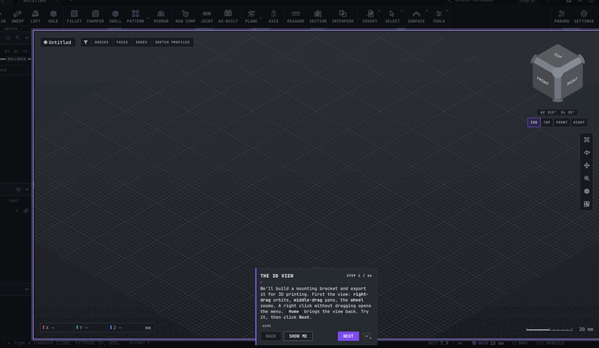

**Step 2.** Open the workspace menu and choose **Part**.

## 2. First sketch

**Step 3.** Click **Create Sketch**.

> It is the first button of the **SKETCH** section of the toolbar.

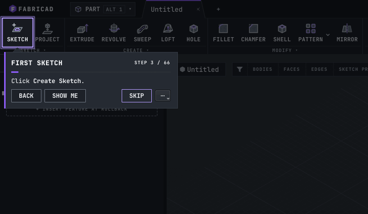

**Step 4.** Click the **XY** plane, the flat one. The view turns to look straight at it.

> Click inside the flat square, not on an edge.

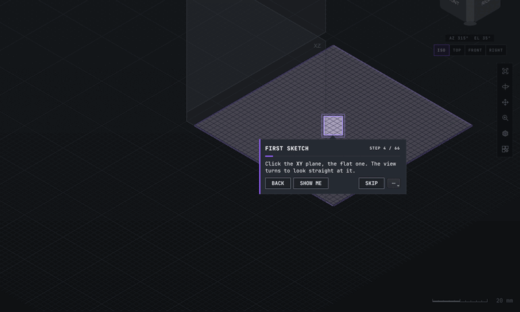

**Step 5.** **Right-click** **Rectangle** (or click its small arrow) and choose **Center Rectangle**.

> A right click on a toolbar button with an arrow opens its menu; a left click runs the button's own tool.

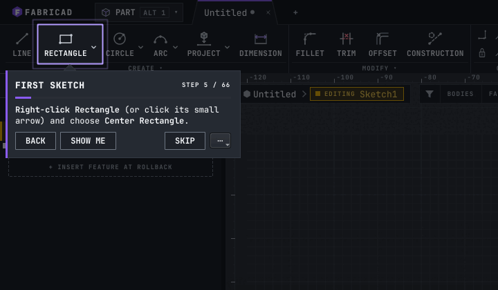

**Step 6.** Click the **origin**, the dot in the middle of the sketch.

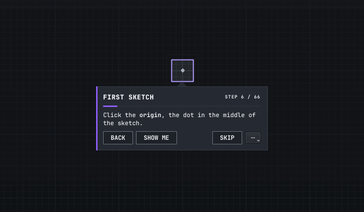

**Step 7.** Type **80**, press <kbd>Tab</kbd>, type **50**, press <kbd>Enter</kbd>. The boxes next to the cursor take the width and the height.

> Type the numbers, don't click a second corner.

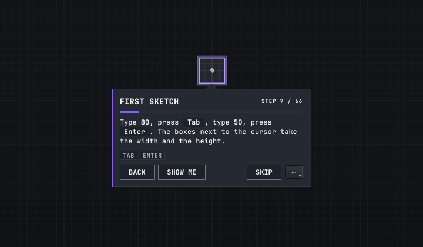

**Step 8.** The rectangle is fully defined: its lines turn white (black in the light theme) and the status bar says **0 DOF**. Click **Finish Sketch**.

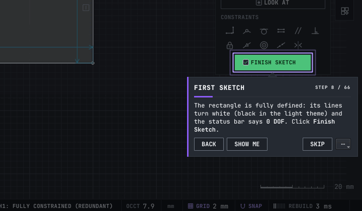

## 3. Extrude

**Step 9.** Press <kbd>Home</kbd> to see the sketch in 3D, then press <kbd>E</kbd> for **Extrude**.

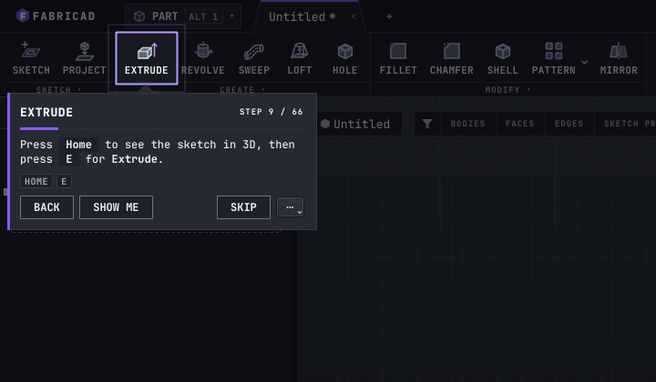

**Step 10.** Click inside the rectangle to use it as the profile.

> Click inside the shaded rectangle, not on its edge.

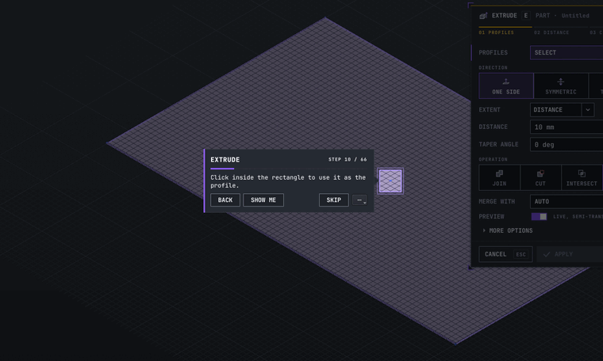

**Step 11.** Type **8** and press <kbd>Enter</kbd>. That is the plate thickness.

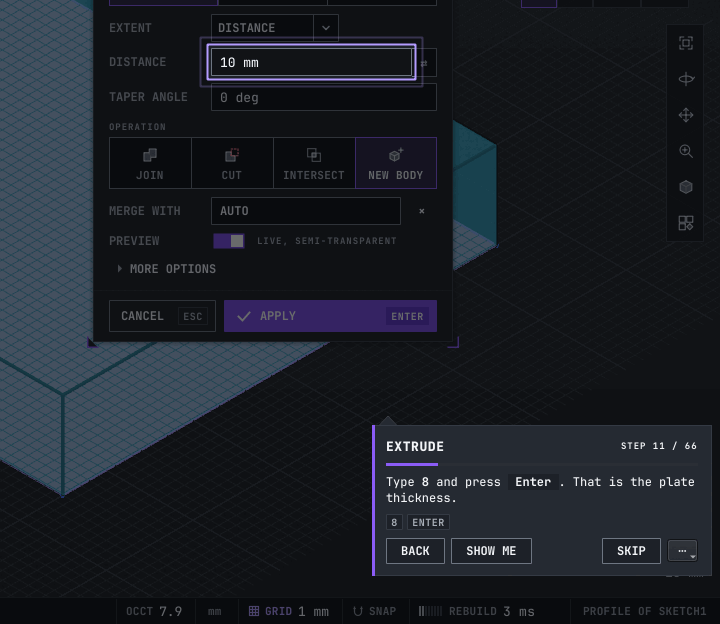

## 4. The flange

**Step 12.** Click the **top face** of the plate.

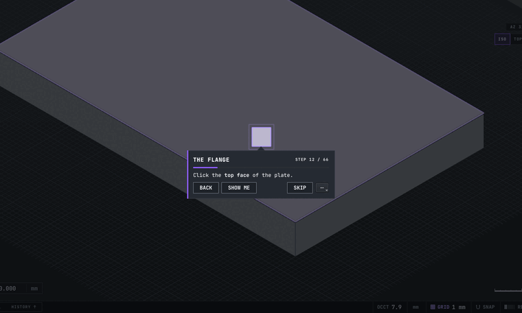

**Step 13.** Click **Create Sketch**: the sketch goes on the selected face.

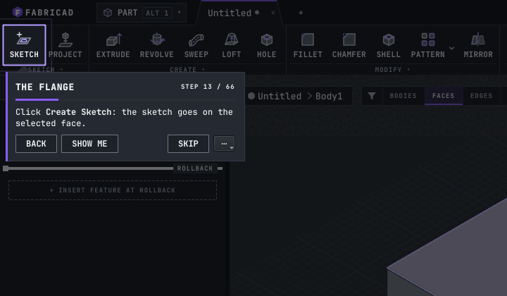

**Step 14.** Press <kbd>P</kbd> (**Project**) and click the top face: its edges come into the sketch as dash-dot lines. Press <kbd>Esc</kbd>.

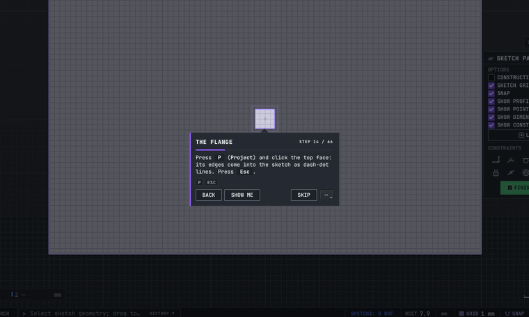

**Step 15.** Press <kbd>L</kbd> (**Line**) and click the **back-left corner** of the plate.

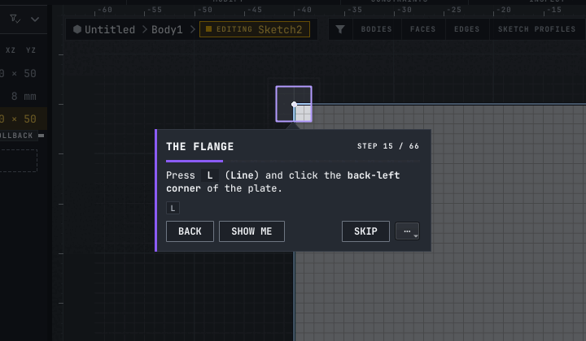

**Step 16.** Move the cursor toward the front, type **10** and press <kbd>Enter</kbd>.

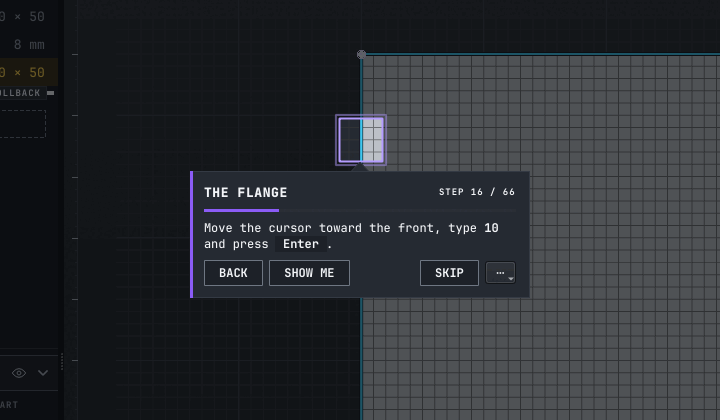

**Step 17.** Move the cursor to the right, type **80** and press <kbd>Enter</kbd>.

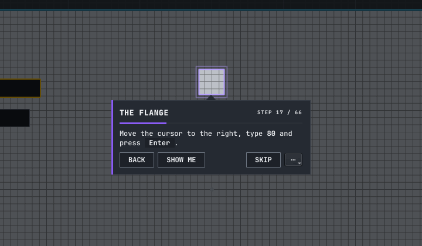

**Step 18.** Click the **back-right corner**: the line snaps to it.

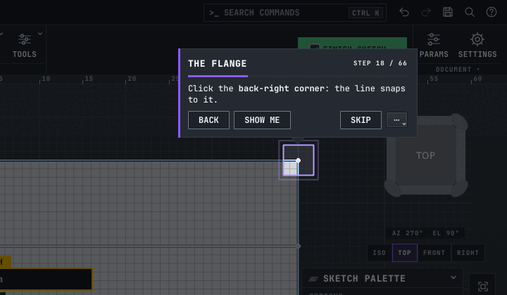

**Step 19.** Click the **start point** to close the outline, then press <kbd>Esc</kbd>. The strip is fully defined: **0 DOF**.

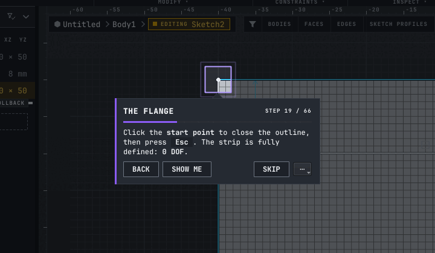

**Step 20.** Press <kbd>Ctrl+Enter</kbd> to finish the sketch.

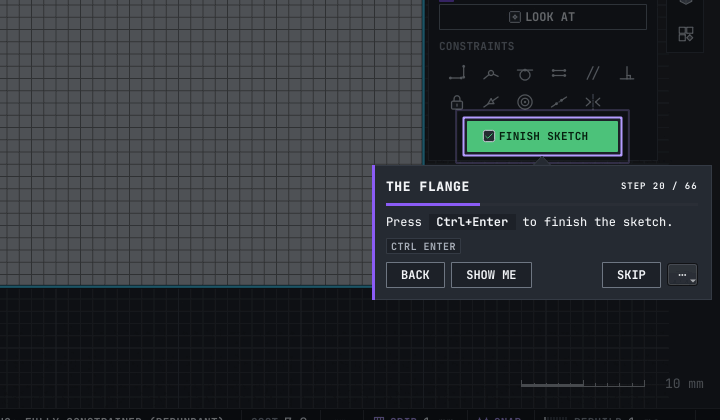

**Step 21.** Press <kbd>E</kbd> and click the narrow strip at the back.

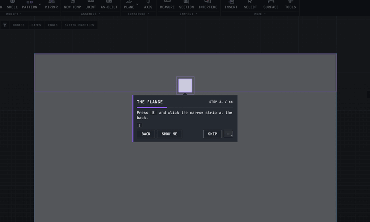

**Step 22.** Type **40** and press <kbd>Enter</kbd>. The flange joins the plate: one body.

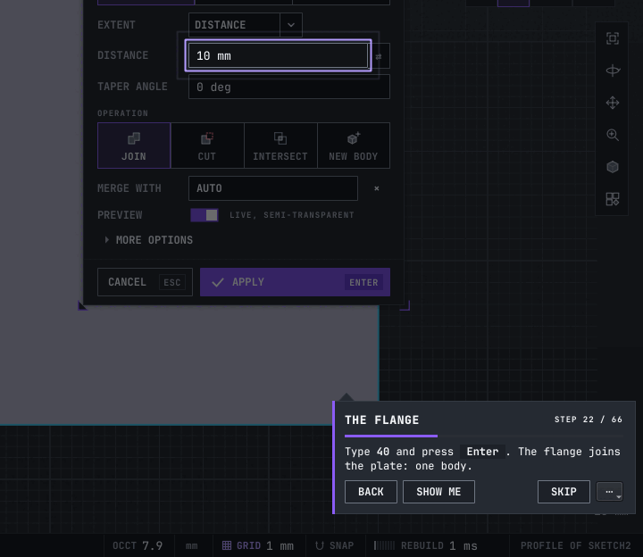

## 5. Fillet

**Step 23.** Press <kbd>Home</kbd>, then <kbd>F</kbd> (**Fillet**), and click the two **front corner edges** (the short vertical ones).

> Hover until the edge lights up, then click; the second one is at the front-left.

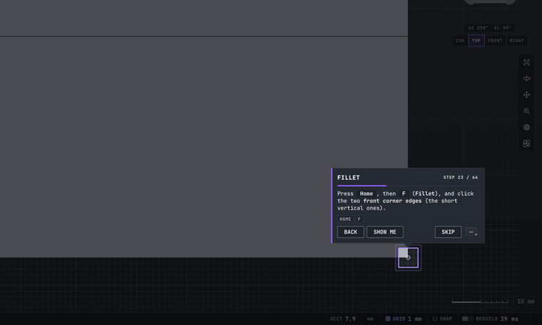

**Step 24.** Type **10** and press <kbd>Enter</kbd>.

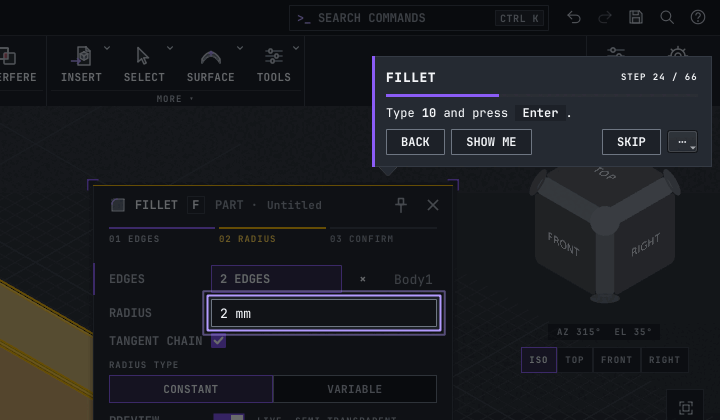

## 6. Slot and cut

**Step 25.** Click the **top face** of the plate again, then **Create Sketch**.

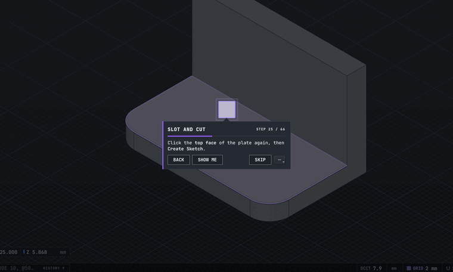

**Step 26.** Press <kbd>P</kbd>, click the top face, press <kbd>Esc</kbd>.

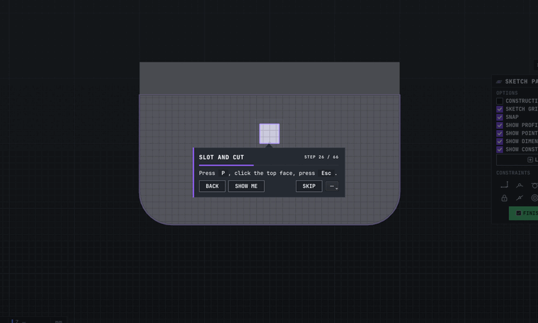

**Step 27.** Open the **Create** menu of the sketch toolbar (click or right-click its caption) and choose **Center to Center Slot**.

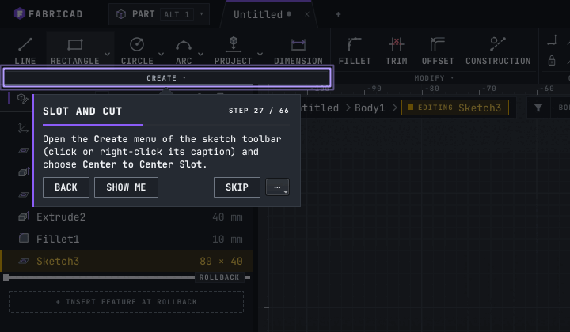

**Step 28.** Click near the **front-left** of the plate for the first arc centre.

> Anywhere there is fine: two dimensions place it exactly in a moment.

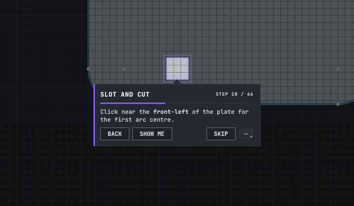

**Step 29.** Move the cursor to the right, type **30** and press <kbd>Enter</kbd>: the distance between the arc centres.

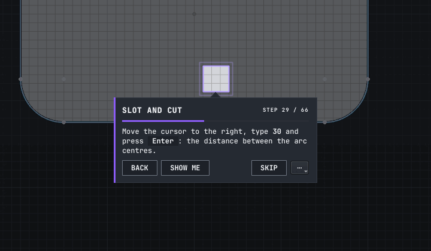

**Step 30.** Type **8** and press <kbd>Enter</kbd> for the width, then <kbd>Esc</kbd>.

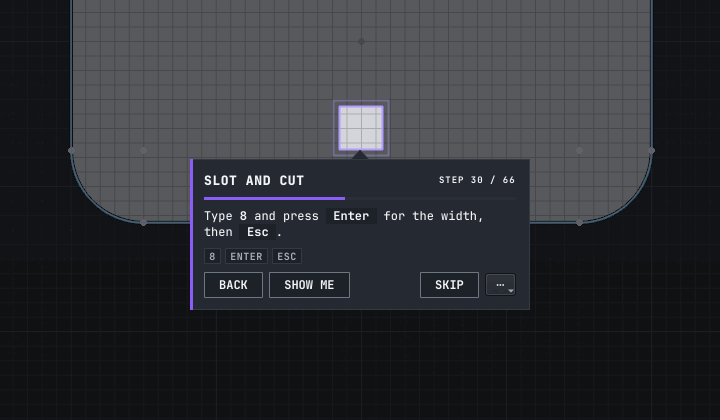

**Step 31.** Press <kbd>D</kbd> (**Dimension**). Click the **left arc centre**, then the **front edge**, click where the text goes, type **10**, <kbd>Enter</kbd>.

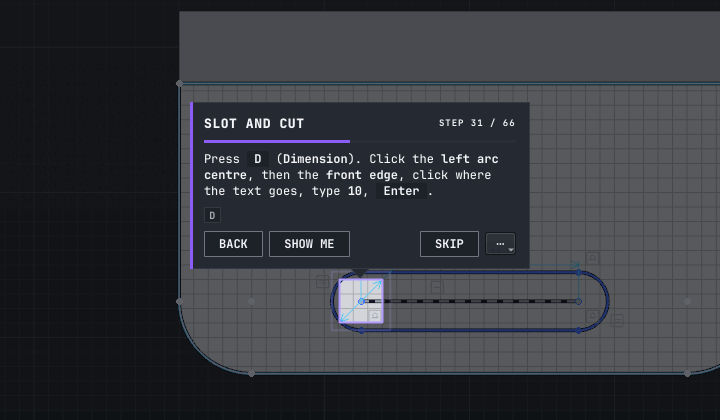

**Step 32.** Now the **left arc centre** and the **left edge**: place the text, type **25**, <kbd>Enter</kbd>, then <kbd>Esc</kbd>. **0 DOF**.

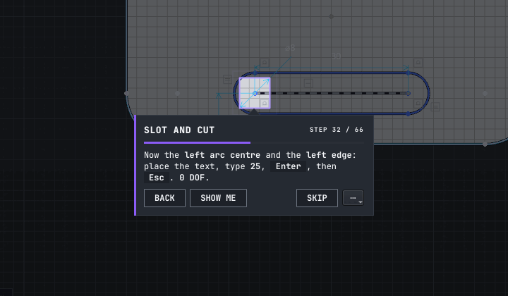

**Step 33.** <kbd>Ctrl+Enter</kbd> finishes the sketch. Press <kbd>Home</kbd>, <kbd>E</kbd> and click **inside the slot**.

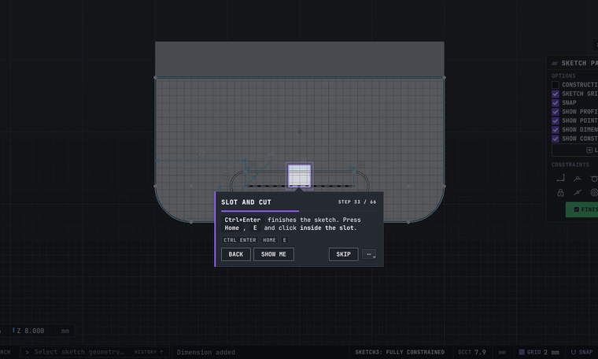

**Step 34.** Click **Cut**, set **Extent** to **All**, press <kbd>Enter</kbd>. The cut goes down into the plate by itself.

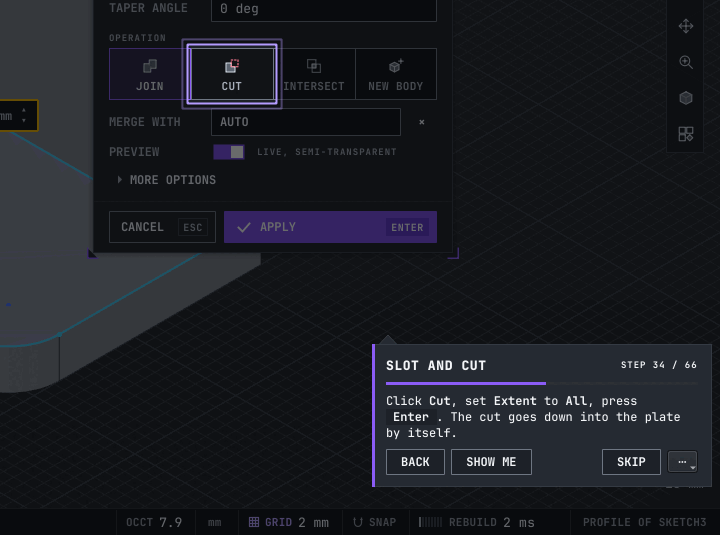

## 7. Holes and mirror

**Step 35.** Press <kbd>H</kbd> (**Hole**) and click the **curved top edge** of the right corner: the hole goes to its centre.

> Hover the rounded corner's top rim until the edge (not the face) lights up.

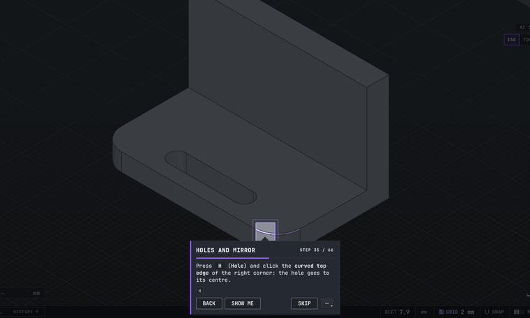

**Step 36.** Choose **Counterbore**, set **Extent** to **All** and the counterbore depth to **4** (Ø 6.6 and Ø 11 are already right). <kbd>Enter</kbd>.

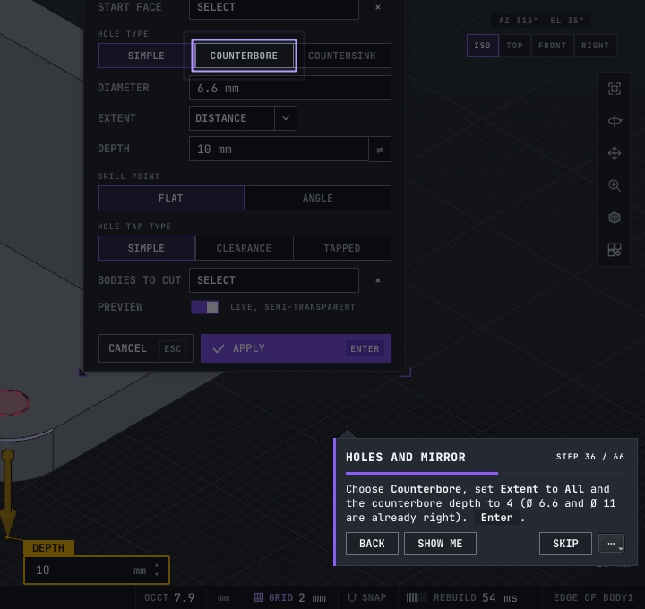

**Step 37.** Click **Hole1** in the FEATURES list.

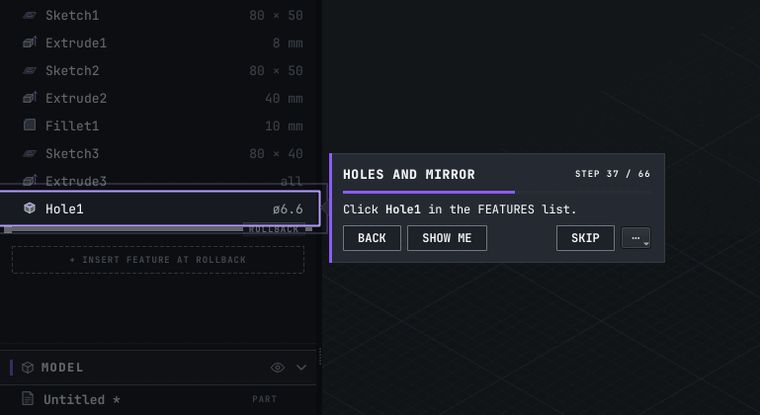

**Step 38.** Click **Mirror** (in the **Modify** section).

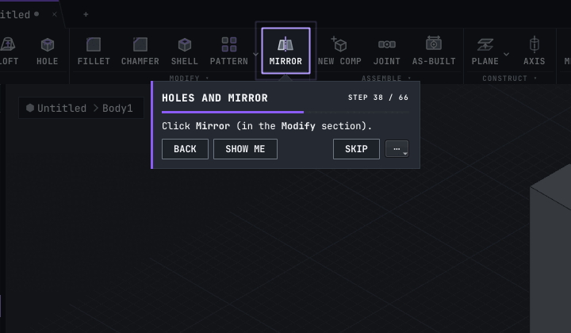

**Step 39.** Click the **Mirror Plane** field, then the **YZ** plane in the view (the one through the middle of the part). <kbd>Enter</kbd>.

> You can also pick **YZ Plane** under **Origin** in the MODEL panel.

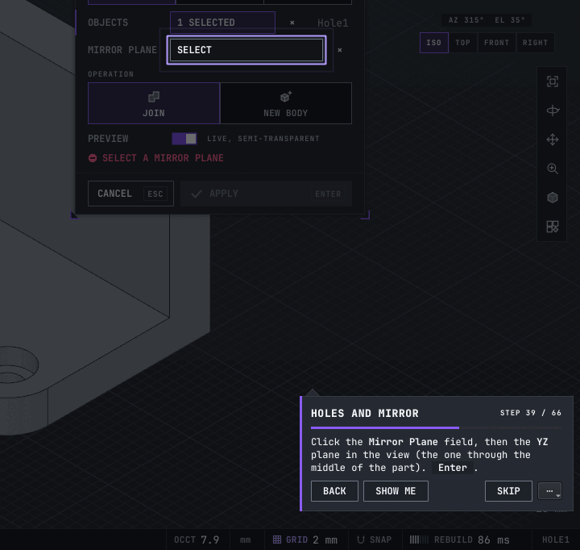

## 8. Flange hole

**Step 40.** Press <kbd>Home</kbd> and click the flange's **front face**, then **Create Sketch**.

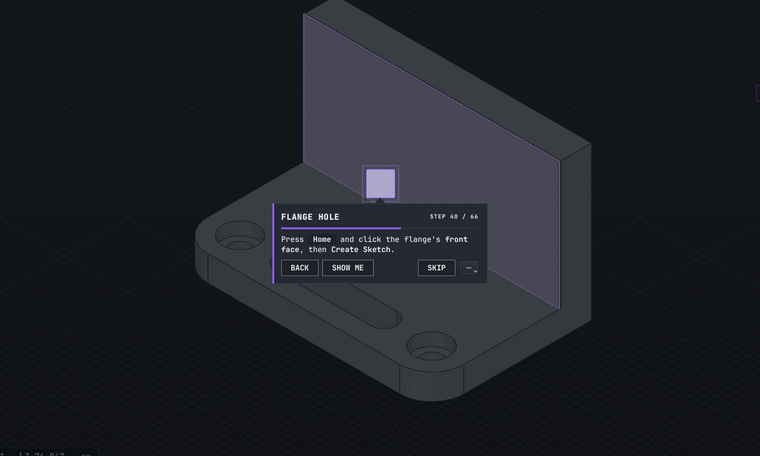

**Step 41.** Press <kbd>P</kbd>, click the face, press <kbd>Esc</kbd>.

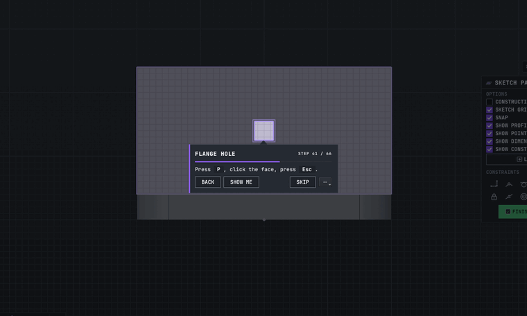

**Step 42.** Press <kbd>C</kbd> (**Circle**), click near the middle of the flange, type **12**, <kbd>Enter</kbd>, <kbd>Esc</kbd>.

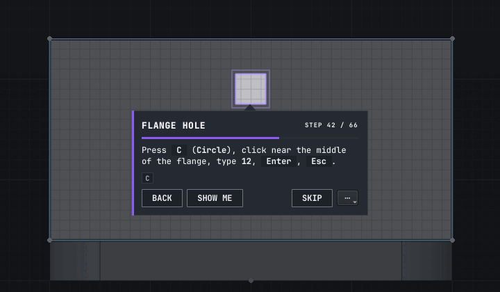

**Step 43.** <kbd>D</kbd>: click the circle's **centre**, then the **top edge**, place the text, type **10**, <kbd>Enter</kbd>.

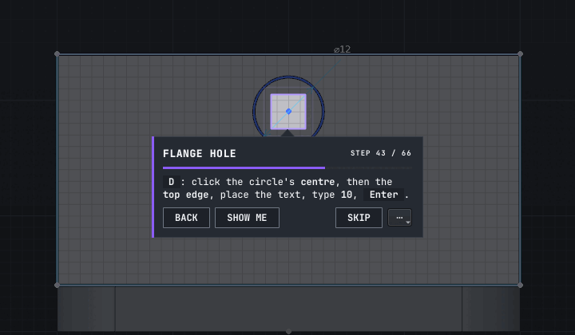

**Step 44.** The **centre** and the **left edge**: type **40**, <kbd>Enter</kbd>, <kbd>Esc</kbd>. **0 DOF**.

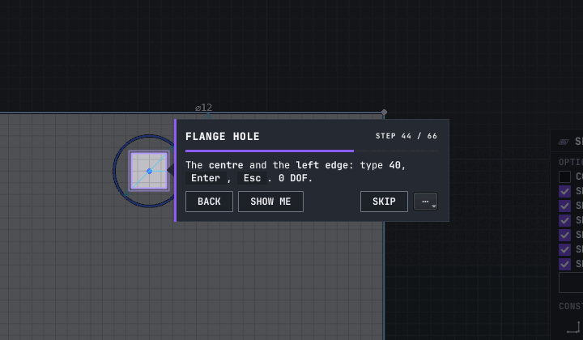

**Step 45.** <kbd>Ctrl+Enter</kbd>, <kbd>Home</kbd>, <kbd>E</kbd> and click **inside the circle**.

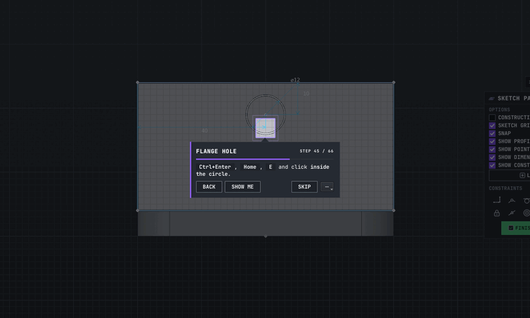

**Step 46.** **Cut**, **Extent: All**, <kbd>Enter</kbd>.

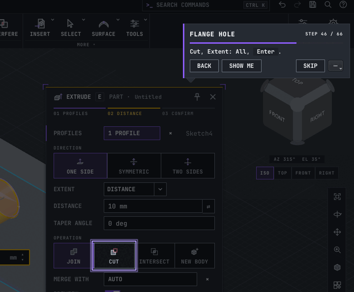

## 9. Chamfer

**Step 47.** Press <kbd>Home</kbd>, click **Chamfer** and click the two **long top edges** of the flange.

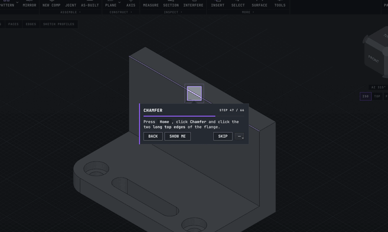

**Step 48.** Type **2** and press <kbd>Enter</kbd>.

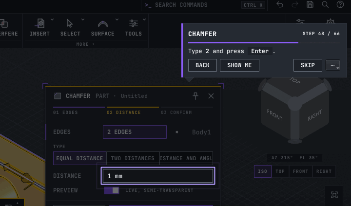

## 10. Rib

**Step 49.** Click **Create Sketch**.

> It is the first button of the **SKETCH** section of the toolbar.

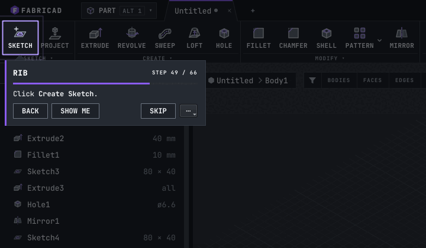

**Step 50.** Click the **YZ** plane, the upright one through the middle of the part.

> You can also pick **YZ Plane** under **Origin** in the MODEL panel.

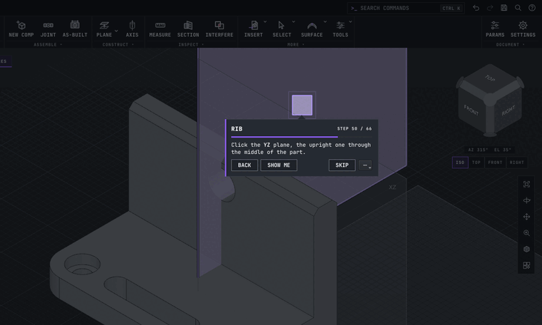

**Step 51.** Press <kbd>P</kbd> and click the part's **right side face**, then <kbd>Esc</kbd>: its L-shaped outline comes into the sketch.

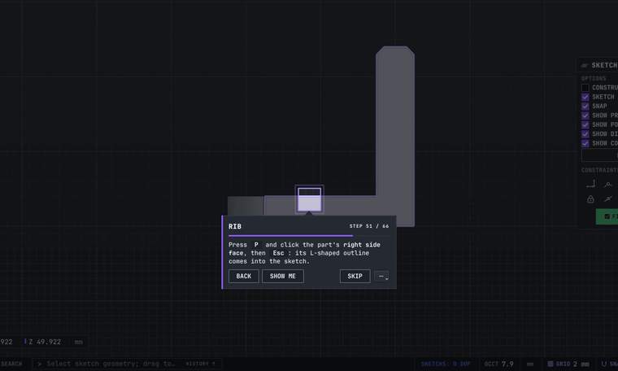

**Step 52.** Press <kbd>L</kbd>. Click the **middle** of the plate's top line (a midpoint marker shows), then the **middle** of the flange line. <kbd>Esc</kbd> twice.

**Step 53.** <kbd>Ctrl+Enter</kbd> finishes the sketch, <kbd>Home</kbd> shows the whole part.

**Step 54.** Open the **Create** menu of the toolbar and choose **Rib**.

**Step 55.** Click the **line** you just drew.

**Step 56.** Type **6** (the rib thickness) and press <kbd>Enter</kbd>.

## 11. Edit the history

**Step 57.** Every feature stays editable. Double-click **Extrude1** in the FEATURES list (scroll up if it is out of sight).

**Step 58.** Change **8** to **10** and press <kbd>Enter</kbd>. Watch the flange, the holes and the rib follow.

## 12. Measure

**Step 59.** Press <kbd>Home</kbd>, then <kbd>I</kbd> (**Measure**), and click the **top rims** of the two counterbores.

> Pick the **top rim** of each counterbore: the larger circle on the top face, not the smaller one at its floor. Click a wrong edge again to drop it.

**Step 60.** The table shows the **distance** between the two rims: 60 mm, centre to centre. Press <kbd>Esc</kbd> to close Measure.

## 13. Save and reopen

**Step 61.** Press <kbd>Ctrl+S</kbd>, type the name **bracket** and press <kbd>Enter</kbd>.

**Step 62.** Close the tab with its **×**.

**Step 63.** Press <kbd>Ctrl+O</kbd> and open **bracket.fcad**.

**Step 64.** Power users: <kbd>Ctrl+9</kbd> opens the **cmd>** line, and `LIST features` prints the whole history as text. Click **Next**.

## 14. Export STL

**Step 65.** Open **Export STL**: it is in the **Tools** menu at the end of the toolbar (under **More** when the window is narrow).

**Step 66.** File: **bracket.stl**. Linear deflection **0.02**, angular **10**, format **Binary**. Press <kbd>Enter</kbd>.

## Done

Done! **bracket.stl** is ready for your slicer. The whole history stays editable: double-click any feature in the FEATURES list to change it.
